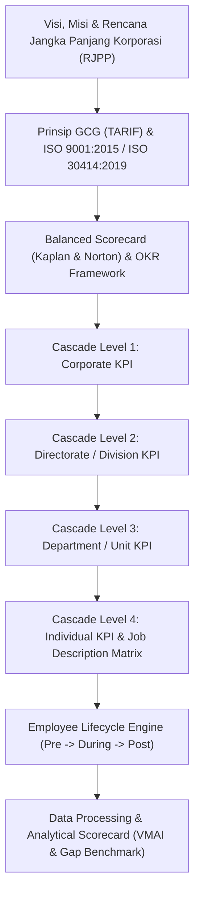
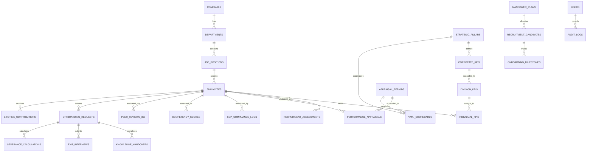
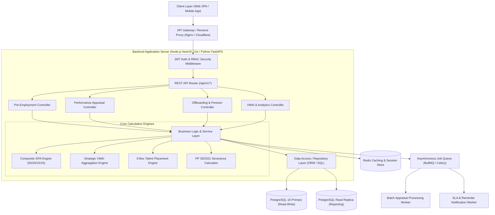
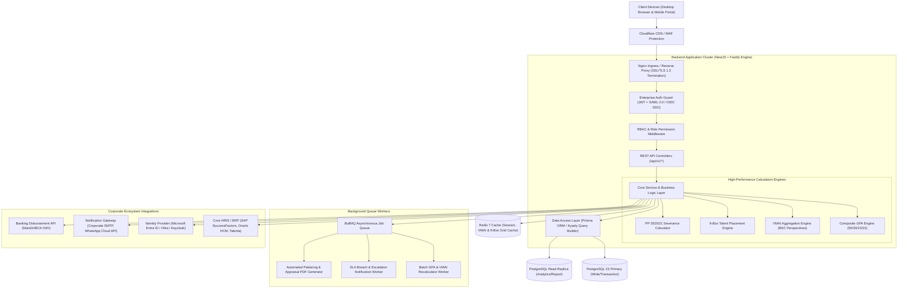

# PRODUCT REQUIREMENTS DOCUMENT (PRD)
# Sistem Manajemen Kinerja Karyawan Terintegrasi Berbasis GCG & Employee Lifecycle
**Nama Proyek:** Enterprise Employee Performance & Lifecycle Analytics (E-PerformIQ)  
**Versi:** 2.0.0  
**Tanggal:** 21 Oktober 2026  
**Klasifikasi:** Confidential / Internal Enterprise Standard  
**Status:** Disetujui untuk implementasi (Revisi 2)

## Revision Log

| Versi | Tanggal | Ringkasan Perubahan | Sifat |
| :--- | :--- | :--- | :--- |
| 1.0.0 | 20 September 2026 | Rilis awal: metodologi BSC/VMAI, matriks KPI lifecycle, ERD, katalog API, rekomendasi stack. | Baseline |
| 2.0.0 | 21 Oktober 2026 | Revisi 2: status kepegawaian, Employee Daily Workspace (KPI harian, DPI, kotak status), Self-Service Center (lembur, BPJS, sanksi & penghargaan, berkas), Career Ladder terukur, e-Surat & disposisi + chat pimpinan, Knowledge & Policy Library, Personal AI Performance Coach, Workforce Activity Feed. | Aditif — seluruh kontrak v1.0.0 dipertahankan |

Penanda **`[BARU v2]`** menandai bagian yang belum ada pada v1.0.0. Penanda **`[DIPERLUAS v2]`** menandai bagian yang sudah ada dan mendapat tambahan pada Revisi 2.

---

## 1. Executive Summary & Visi Produk

### 1.1 Latar Belakang
Pengelolaan kinerja karyawan di perusahaan terkemuka (*Tier-1 Enterprise / BUMN Unggul / Fortune 500*) menuntut integrasi yang kohesif antara **Visi & Misi Perusahaan**, **Tata Kelola Perusahaan yang Baik (Good Corporate Governance - GCG)**, dan **Siklus Hidup Karyawan (Employee Lifecycle - ELC)**. 

Banyak organisasi menghadapi fenomena *silo assessment*, di mana evaluasi rekrutmen tidak terhubung dengan kinerja harian, dan data kontribusi karyawan hilang saat karyawan mengundurkan diri (resign/pensiun). Akibatnya, manajemen puncak tidak memiliki visibilitas data holistik mengenai apakah investasi sumber daya manusia (SDM) benar-benar menggerakkan pencapaian target strategis korporasi.

### 1.2 Tujuan Produk
Aplikasi **E-PerformIQ** dirancang untuk:
1. **Mengotomatisasi & Mengintegrasikan Pengukuran Kinerja** mulai dari tahap *Pre-employment* (Perencanaan, Rekrutmen, Orientasi), *During Employment* (Jobdesk, KPI/GPA, SOP, Kompetensi), hingga *Post-employment* (Handover, Exit Clearance, Hak Pensiun/Pesangon, dan Lifetime Contribution Index).
2. **Menjamin Tata Kelola yang Baik (GCG)** melalui prinsip **TARIF** (*Transparency, Accountability, Responsibility, Independency, Fairness*).
3. **Menyediakan Mesin Analitik Strategis (*Strategic Alignment Engine*)** yang mengagregasi ribuan poin data individual untuk mengukur deviasi terhadap Standar Industri Terkemuka (*Industry Benchmarks*) serta menghitung **Vision & Mission Alignment Index (VMAI)**.
4. **Memberi karyawan kendali penuh atas performanya sendiri** melalui portal layanan mandiri harian: absensi, pengisian KPI harian, pelatihan, cuti dan lembur, jenjang karir, e-Surat, dokumen SOP/PP, hingga asisten AI yang menjawab berdasarkan data performanya yang sebenarnya. **`[BARU v2]`**

---

## 2. Landasan Metodologi & Standar Resmi Industri

Aplikasi ini dibangun mengacu pada standar tata kelola dan pengukuran SDM internasional yang diakui:



1. **Balanced Scorecard (BSC) - Kaplan & Norton:** 4 Perspektif Kinerja (Finansial, Pelanggan, Proses Bisnis Internal, Pembelajaran & Pertumbuhan).
2. **Kriteria Penilaian Kinerja Unggul (KPKU / Malcolm Baldrige):** Standardisasi pengukuran efektivitas kepemimpinan dan manajemen tenaga kerja.
3. **ISO 30414:2019 (Human Resource Management - Guidelines for Human Capital Reporting):** Standar internasional metrik tenaga kerja (produktivitas, turnover biaya, suksesi, kepatuhan).
4. **9-Box Talent Matrix (McKinsey / GE):** Segmentasi karyawan berdasarkan Kinerja (*Performance*) vs Potensi (*Potential*).
5. **Regulasi Ketenagakerjaan Nasional:** UU Ketenagakerjaan No. 13/2003, UU Cipta Kerja No. 6/2023, PP No. 35/2021 (PKWT, Alih Daya, Waktu Kerja, dan Pemutusan Hubungan Kerja), serta regulasi DPLK/BPJS Ketenagakerjaan.

---

## 3. Matriks Indeks KPI End-to-End Employee Lifecycle

Sistem membagi penilaian ke dalam 3 fase utama dengan metrik formal berbobot:

```
+----------------------------------------------------------------------------------------------------+
|                                    EMPLOYEE LIFECYCLE EVALUATION                                   |
+---------------------------------+----------------------------------+-------------------------------+
|       1. PRE-EMPLOYMENT         |       2. DURING EMPLOYMENT       |       3. POST-EMPLOYMENT      |
|  - MPP Fulfillment Rate         |  - Cascaded KPI (BSC / OKR)      |  - Knowledge Handover Index   |
|  - Quality of Hire (QoH)        |  - GPA (Performance Score)       |  - Regrettable Attrition Rate |
|  - Recruitment SLA & Cost       |  - SOP & Compliance Adherence    |  - Exit Sentiment Analysis    |
|  - 30-60-90 Day Onboarding Fit  |  - Core & Competency Index       |  - Severance & Pension SLA    |
|  - Probation Conversion Rate    |  - 360 Feedback & Core Values    |  - Lifetime Contribution Index|
+---------------------------------+----------------------------------+-------------------------------+
```

### 3.1 Fase 1: Pra-Bekerja (Pre-Employment)

Tujuan: Memastikan tenaga kerja yang masuk sesuai perencanaan strategis, kompeten, dan cepat beradaptasi.

| Kode Indeks | Nama Indeks KPI | Rumus / Metodologi Pengukuran | Target Benchmark Industri | Bobot Standar |
| :--- | :--- | :--- | :--- | :--- |
| **PRE-01** | **MPP Alignment Ratio** (Kesesuaian Formasi SDM) | $\frac{\text{Jumlah Kebutuhan Terpenuhi}}{\text{Kebutuhan Disetujui dalam Manpower Plan}} \times 100\%$ | $95\% - 100\%$ | 20% |
| **PRE-02** | **Quality of Hire (QoH)** | Rata-rata Skor: (Hasil Tes Teknis + Skor Psikometri + Skor Wawancara Kompetensi + Skor Evaluasi Probation) | $\ge 85 / 100$ | 25% |
| **PRE-03** | **Time-to-Fill SLA** | Waktu sejak Permintaan Tenaga Kerja (FPTK) disetujui hingga kandidat menandatangani Offering Letter | Manajerial: $\le 45$ hari<br>Staf: $\le 25$ hari | 15% |
| **PRE-04** | **Cost per Hire Efficiency** | $\frac{\text{Total Biaya Rekrutmen (Iklan + Vendor + Asesmen)}}{\text{Total Karyawan Diterima}}$ vs Anggaran Rekrutmen | Varians $\le \pm 5\%$ dari budget | 10% |
| **PRE-05** | **Onboarding Assimilation Index (30-60-90 Days)** | Evaluasi berkala: pemahaman jobdesk (30 hari), penguasaan sistem/alat (60 hari), kontribusi proyek independen (90 hari) | Skor $\ge 80\%$ pada hari ke-90 | 15% |
| **PRE-06** | **Probation Success Rate** | $\frac{\text{Karyawan Lolos Percobaan Tanpa Perpanjangan}}{\text{Total Karyawan Probation}} \times 100\%$ | $\ge 90\%$ | 15% |

---

### 3.2 Fase 2: Saat Bekerja (During Employment)

Tujuan: Mengukur eksekusi harian, kontribusi output target, kepatuhan proses (SOP), dan pengembangan kapabilitas.

Sistem menghitung **Composite Grade Point Average (GPA) Karyawan** dengan formula:

$$\text{Total Performance Score (GPA)} = (W_{\text{kpi}} \times S_{\text{kpi}}) + (W_{\text{sop}} \times S_{\text{sop}}) + (W_{\text{comp}} \times S_{\text{comp}}) + (W_{\text{val}} \times S_{\text{val}})$$

*Keterangan: $W$ = Bobot (Weight), $S$ = Skor (Score).*

| Kode Indeks | Komponen Penilaian | Parameter Pengukuran | Target Benchmark | Bobot Standar |
| :--- | :--- | :--- | :--- | :--- |
| **DUR-01** | **Cascaded Individual KPI** | Realisasi output kerja spesifik per peran berdasarkan 4 pilar Balanced Scorecard (Finansial, Pelanggan, Internal, Inovasi) | $\ge 100\%$ pencapaian target SMART | **50%** |
| **DUR-02** | **SOP & SLA Compliance Index** | - Tingkat kesalahan prosedur (*error rate*) <br>- Audit temuan non-compliance (ISO internal/audit eksternal) <br>- Ketepatan waktu SLA tugas operasional | 0 Fatal Error, <br>SLA $\ge 98\%$ | **20%** |
| **DUR-03** | **Competency Mastery (Hard & Soft Skills)** | Asesmen kesenjangan kompetensi (*Skill Gap Analysis*) berdasar standar kamus kompetensi jabatan (Level 1-5) | Skill Gap Index $\le 0.15$ | **15%** |
| **DUR-04** | **Core Values & 360° Feedback** | Evaluasi perilaku kerja berdasarkan Nilai Luhur Budaya Perusahaan (contoh: AKHLAK / Integritas / Kolaborasi) dinilai oleh Atasan, Rekan, dan Bawahan | Skor Peer Review $\ge 4.2 / 5.0$ | **15%** |

#### Sub-Matriks Pengukuran Tambahan (Operasional):
* **Kehadiran & Disiplin (Attendance Adherence):** Toleransi keterlambatan $< 0.5\%$, Indeks Bradford $< 45$.
* **Training Hours & Effectiveness (Kirkpatrick Level 2 & 3):** Minimal 24 Jam Pelatihan/tahun/karyawan dengan Pre-Test vs Post-Test Delta $\ge +25\%$.
* **Continuous Improvement / Ide Inovasi:** Minimal 1 usulan Kaizen / ide perbaikan proses per semester.
* **Daily KPI Entry Adherence:** Persentase hari kerja dengan entri KPI harian lengkap. Target $\ge 95\%$; hari kerja tanpa entri dianggap *not measured*, bukan nol. **`[BARU v2]`**
* **Daily Performance Index (DPI):** Skor harian berbobot dari realisasi indikator KPI, dipakai sebagai sinyal dini (*early warning*) sebelum periode penilaian berakhir. Rumus pada §4.3. **`[BARU v2]`**

---

### 3.3 Fase 3: Pasca Bekerja (Post-Employment)

Tujuan: Mengamankan kelangsungan bisnis (*business continuity*), mitigasi risiko kebocoran data, pemenuhan hak legal, dan audit reputasi perusahaan.

| Kode Indeks | Nama Indeks KPI | Parameter & Metode Pengukuran | Target Benchmark | Bobot Standar |
| :--- | :--- | :--- | :--- | :--- |
| **PST-01** | **Knowledge Handover & Asset Clearance** | Persentase serah terima dokumen, proyek berjalan, akses kredensial, dan aset fisik sebelum *Last Working Day* (LWD) | $100\%$ tuntas sebelum LWD | 25% |
| **PST-02** | **Regrettable Attrition Rate** | Rasio turnover karyawan berkinerja tinggi (*Talent High-Potential* / Top 20% 9-Box) | $\le 3\%$ per tahun | 20% |
| **PST-03** | **Exit Interview Sentiment & Root Cause Index** | Analisis tematik alasan keluar (Kompensasi, Kepemimpinan, Lingkungan Kerja, Jalur Karir) untuk perbaikan GCG | Audit kepuasan exit $\ge 75\%$ | 15% |
| **PST-04** | **Severance & Pension Handover SLA** | Ketepatan waktu penghitungan dan transfer hak pesangon/DPLK/JHT BPJS Ketenagakerjaan sesuai PP 35/2021 | 100% dibayarkan $\le 7$ hari kerja dari LWD | 20% |
| **PST-05** | **Lifetime Contribution Index (LCI)** | Nilai akumulatif pencapaian masa bakti: <br>$\text{LCI} = \sum (\text{Skor KPI Tahunan} \times \text{Bobot Peran}) + \text{Inovasi/Paten}$ | Terarsip dalam Talent Legacy Hall of Fame | 20% |

---

## 4. Analisis Konsep: Strategic Alignment Engine (VMAI)

Bagaimana membuktikan apakah seluruh hasil KPI tersebut selaras dengan **Visi dan Misi Perusahaan** serta standar resmi korporasi terkemuka?

```mermaid
flowchart LR
    subgraph InputData["Input Data Multidimensi"]
        D1["Data Pre-Employment (QoH, SLA)"]
        D2["Data During-Employment (KPI, SOP, Core Values)"]
        D3["Data Post-Employment (Clearance, Retention)"]
    end

    subgraph Processing["Strategic Alignment Engine"]
        P1["Normalisasi Data (Z-Score & Min-Max)"]
        P2["Bobot Strategis Berdasarkan Visi-Misi Matrix"]
        P3["Benchmark Gap Analysis (Perbandingan Standar Industri)"]
    end

    subgraph Output["Output Analisis Eksekutif"]
        O1["Vision & Mission Alignment Index (VMAI)"]
        O2["Strategic Pillar Heatmap"]
        O3["Rekomendasi Kebijakan GCG Otomatis"]
    end

    InputData --> Processing --> Output
```



### 4.1 Vision & Mission Alignment Index (VMAI) Formula

Setiap Visi dan Misi dijabarkan menjadi **Pilar Strategis Korporasi ($P_j$)**. Setiap KPI karyawan diwajibkan memiliki *tagging* kontribusi terhadap salah satu pilar strategis:

$$VMAI = \sum_{j=1}^{M} W_{P_j} \times \left( \frac{\sum_{i=1}^{N_j} (\text{Achieved KPI}_{i} \times W_{i})}{\sum_{i=1}^{N_j} (\text{Target KPI}_{i} \times W_{i})} \times \text{GCG Compliance Factor}_{j} \right)$$

*Di mana:*
* $W_{P_j}$ = Bobot prioritas pilar strategis dari Dewan Direksi / RUPST (Total = 1.0).
* $\text{GCG Compliance Factor}_j$ = Faktor pengali kepatuhan $(0.0 - 1.0)$ berdasarkan audit kepatuhan SOP & etika bisnis. Jika ada pelanggaran fatal GCG, nilai pilar dapat dikurangi secara proporsional.

### 4.2 Kategori Status Keselarasan Strategis (VMAI Thresholds)
* **$\ge 95\%$ (Exceptional Strategic Alignment):** Kinerja SDM melampaui standar industri terkemuka; akselerasi tercapainya visi perusahaan berada di jalur cepat.
* **$85\% - 94.9\%$ (Healthy & Aligned):** Berada pada koridor standar perusahaan terkemuka (*Industry Best Practice*). Tata kelola berjalan tertib.
* **$70\% - 84.9\%$ (Sub-Standard / Gap Identified):** Terjadi deviasi pada salah satu fase lifecycle (misal: turnover tinggi atau kepatuhan SOP rendah). Memerlukan koreksi manajemen.
* **$< 70\%$ (Critical Misalignment):** Aktivitas karyawan tidak berkontribusi pada pencapaian visi dan misi, atau terjadi pelanggaran berat pada pilar GCG.

---

### 4.3 Daily Performance Index (DPI) & Kotak Status Harian `[BARU v2]`

VMAI dan GPA mengukur kinerja pada horizon periode (bulanan/semesteran). Untuk keputusan operasional harian, sistem menambahkan **Daily Performance Index (DPI)** yang dihitung dari entri KPI harian per indikator (§10.3), bukan dari angka periode.

$$\text{DPI} = \frac{\sum_{i=1}^{n} w_i \times \min\left(a_i,\ 1{,}20\right)}{\sum_{i=1}^{n} w_i} \times 100$$

Dengan $a_i$ adalah rasio capaian indikator ke-$i$:

$$
a_i =
\begin{cases}
\dfrac{\text{Actual}_i}{\text{Target}_i}, & \text{direction} = \text{HIGHER\_BETTER} \\[6pt]
\dfrac{\text{Target}_i}{\max(\text{Actual}_i,\ 0{,}01)}, & \text{direction} = \text{LOWER\_BETTER}
\end{cases}
$$

Batas atas $1{,}20$ mencegah satu indikator yang jauh melampaui target menutupi indikator lain yang gagal. Indikator dengan `frequency` bukan `DAILY` tidak masuk perhitungan DPI harian dan tetap dinilai pada periode.

#### 4.3.1 Ambang Kotak Status (Traffic Light)

Ambang disimpan sebagai konfigurasi perusahaan (`company_dpi_settings`) agar dapat disesuaikan tanpa mengubah kode.

| Status | Rentang DPI | Makna Operasional | Tindakan yang Diharapkan |
| :--- | :--- | :--- | :--- |
| **Hijau** | $\ge 90$ | Kinerja hari ini sesuai atau melampaui target indikator. | Tidak ada tindakan; masuk rekap positif. |
| **Kuning** | $70 - 89{,}99$ | Ada deviasi yang belum kritis. | Atasan meninjau pada review mingguan; karyawan melihat indikator mana yang tertinggal. |
| **Merah** | $< 70$ | Deviasi signifikan atau indikator kunci tidak terpenuhi. | Notifikasi ke atasan langsung pada hari yang sama; wajib rencana perbaikan. |
| **Abu-abu** (`NO_DATA`) | Tidak ada entri | Hari belum diisi atau bukan hari kerja. | Pengingat otomatis pukul 16.00 zona waktu kantor. |

Status disimpan sebagai enum `traffic_light_enum` (`GREEN`, `YELLOW`, `RED`, `NO_DATA`).

#### 4.3.2 Modifikator Kehadiran

DPI murni mengukur output. Kehadiran diterapkan sebagai modifikator terpisah agar satu pelanggaran disiplin tidak menghapus sinyal performa:

| Kondisi Kehadiran | Efek pada Status |
| :--- | :--- |
| Hadir (WFO/WFH) atau cuti/izin resmi disetujui | Tidak ada perubahan |
| Terlambat melebihi toleransi | Status tetap, ditandai badge disiplin |
| **Alpa** (tanpa keterangan) | Status **diturunkan satu tingkat** (Hijau → Kuning, Kuning → Merah) |

#### 4.3.3 Aturan Rollup ke Penilaian Periode

Entri harian tidak menggantikan penilaian periode; ia mengisi `individual_kpis.actual_value` pada akhir periode menurut aturan agregasi indikator:

| `aggregation` | Perilaku | Contoh Indikator |
| :--- | :--- | :--- |
| `SUM` | Menjumlah seluruh entri dalam periode | Jumlah unit terjual, jumlah tiket selesai |
| `AVG` | Rata-rata entri harian | Skor kualitas layanan harian |
| `LAST` | Nilai entri terakhir pada periode | Saldo akhir, level stok |
| `MAX` | Nilai tertinggi | Waktu respons terburuk yang dicatat |

Rollup bersifat idempoten dan dijalankan ulang setiap kali entri diverifikasi, sehingga GPA, VMAI, dan 9-Box v1.0.0 tetap memakai rumus yang sama tanpa perubahan.

#### 4.3.4 Snapshot & Rekap

`daily_performance_snapshots` menyimpan hasil DPI per karyawan per tanggal (status, DPI, jumlah indikator terisi, alasan penurunan status). Snapshot dipakai untuk tiga rekap tanpa menghitung ulang riwayat:

* **Harian:** DPI hari ini, status, tren 7 hari terakhir, indikator terlemah.
* **Bulanan:** rata-rata DPI berbobot hari kerja, jumlah hari Hijau/Kuning/Merah, komponen KPI pada GPA, kehadiran, jam pelatihan.
* **Tahunan:** agregasi 12 bulan, posisi 9-Box, kontribusi VMAI, tren antar-tahun.

---

## 5. Fitur Utama & Spesifikasi Fungsional Produk

### 5.1 Modul 1: Pre-Employment Talent Gateway
* **Manpower Planning Tracker:** Dashboard kuota formasi tahunan vs realisasi rekrutmen. Notifikasi otomatis jika departemen mengajukan formasi di luar anggaran.
* **Smart Assessment Scoring:** Input skor psikotes, studi kasus, wawancara berbasis kompetensi (*STAR Method*) dengan konversi otomatis ke *Quality of Hire (QoH)*.
* **Probation Milestone Tracker (30-60-90 Hari):** Form digital otomatis berisi target kerja transisi yang dinilai oleh atasan langsung pada interval 30 hari.

### 5.2 Modul 2: Dynamic KPI & Performance Appraisal (During-Employment)
* **Goal Cascading Tree:** Visualisasi pohon cascading dari KPI Korporasi $\to$ KPI Divisi $\to$ KPI Unit $\to$ KPI Individu. Memastikan tidak ada KPI individual yang terisolasi dari visi-misi perusahaan.
* **SOP & Operational SLA Monitor:** Modul integrasi tiket operasional untuk mendeteksi deviasi waktu kerja dan pelanggaran standar operasional prosedur.
* **9-Box Talent Placement Matrix:** Pemetaan otomatis karyawan dalam kuadran 9-Box (Potential vs Performance) untuk perencanaan suksesi (*Succession Planning*).
* **Multi-Rater 360 Assessment:** Penilaian berkala anonim terenkripsi untuk pilar budaya perusahaan dan kepemimpinan.

### 5.3 Modul 3: Offboarding, Governance & Legacy Vault (Post-Employment)
* **Digital Clearance Workflow:** Serah terima tugas bertingkat (*Knowledge Transfer Checklist*, pengembalian laptop/akses, audit keuangan operasional).
* **Exit Interview AI Analytics:** Analisis sentimen teks dari sesi wawancara keluar (*exit survey*) untuk mengelompokkan alasan resign utama secara objektif.
* **Pension & Severance Handover Estimator:** Kalkulator otomatis kompensasi PHK/Pensiun berdasar masa kerja, gaji pokok, dan regulasi PP 35/2021 & DPLK secara presisi.
* **Alumni Legacy Registry:** Repositori arsip portofolio pencapaian historis karyawan selama mengabdi untuk kemitraan korporasi di masa depan.

### 5.4 Modul 4: Strategic Executive Analytics & Gap Benchmark
* **Vision & Mission Radar Chart:** Perbandingan realisasi kinerja vs target strategis vs benchmark kompetitor sejenis.
* **Predictive Attrition & Burnout Warning:** Deteksi dini potensi penurunan produktivitas dan turnover risiko tinggi melalui anomali absensi dan beban kerja.
* **Audit Trail & GCG Compliance Log:** Seluruh perubahan nilai KPI, riwayat persetujuan (*approval history*), dan catatan komite kalibrasi tersimpan dengan cap waktu (*timestamp*) anti-tamper.

---

### 5.5 Modul 5: Employee Daily Workspace `[BARU v2]`

Ruang kerja harian karyawan. Semua layar dirancang *mobile-first* karena mayoritas pengisian dilakukan dari ponsel pada jam kerja.

* **Absensi Harian:** check-in/check-out dengan foto dan geolokasi (memperluas `attendance_logs` yang sudah berjalan), penanda WFO/WFH/dinas luar, serta **pengajuan koreksi absensi** bila terjadi kesalahan mesin. WFO/WFH/dinas luar disimpan pada kolom baru `attendance_logs.work_mode`; koreksi disimpan pada tabel `attendance_corrections` agar data mesin asli tidak pernah ditimpa.
* **Pengisian KPI Harian per Indikator:** karyawan memilih indikator aktif miliknya, mengisi nilai realisasi, catatan singkat, dan bukti (opsional). Target waktu pengisian $\le 2$ menit per hari. Entri disimpan sebagai `DRAFT` sampai dikirim; entri yang dikirim setelah pukul 23.59 waktu kantor ditandai `is_late = true` tanpa ditolak. **DPI hanya menghitung entri berstatus `SUBMITTED` atau `VERIFIED`.**
* **Kotak Status Hari Ini:** kartu berwarna Hijau/Kuning/Merah/Abu-abu (§4.3.1) beserta alasan penurunan status dan daftar indikator yang tertinggal.
* **Rekap Kinerja:** tab Harian, Bulanan, dan Tahunan (§4.3.4) dengan grafik tren dan rincian per indikator.
* **Verifikasi Atasan:** antrean verifikasi entri harian bawahan; atasan dapat menyetujui, menolak dengan alasan, atau meminta bukti tambahan. Penolakan mengembalikan entri ke `DRAFT` dan tidak dihitung dalam DPI.

### 5.6 Modul 6: Employee Self-Service Center `[DIPERLUAS v2]`

Memperluas portal karyawan yang sudah berjalan menjadi satu pintu layanan kepegawaian.

* **Cuti & Izin:** pengajuan dan saldo cuti (sudah ada), ditambah kalender tim agar karyawan melihat benturan jadwal sebelum mengajukan.
* **Pengajuan Lembur:** rencana lembur (tanggal, perkiraan jam, alasan, penugasan) diajukan sebelum bekerja; persetujuan atasan menjadi syarat agar jam lembur masuk `attendance_logs.total_overtime_hours` dan dihitung pada payroll. Lembur tanpa persetujuan tetap tercatat sebagai kehadiran, tetapi tidak dibayar. **`[BARU v2]`**
* **Berkas Kepegawaian:** unggah dan pembaruan dokumen (KTP, KK, ijazah, sertifikat, SK, NPWP) dengan status verifikasi HRD, tanggal kedaluwarsa, dan pengingat perpanjangan. **`[BARU v2]`**
* **Kartu BPJS Ketenagakerjaan & Kesehatan:** nomor peserta, **kelas perawatan**, dan status aktif. Nomor ditampilkan **ter-masking** (4 digit terakhir); pembukaan penuh memerlukan verifikasi ulang sesi dan tercatat di audit log. **`[BARU v2]`**
* **Gaji, Lembur & Slip:** slip gaji (sudah ada), ditambah rincian komponen lembur per periode dan riwayat pembayaran.
* **Sanksi & Penghargaan:** daftar Surat Peringatan (SP1/SP2/SP3/teguran) beserta alasan, tanggal berlaku, dan masa berlaku; daftar penghargaan beserta sertifikat. Karyawan berhak mengajukan **keberatan** dalam 5 hari kerja; keberatan tidak menghapus catatan, hanya menandainya `UNDER_APPEAL`. **`[BARU v2]`**
* **Status Kepegawaian:** status (Probation/PKWT/PKWTT/Tetap), tanggal bergabung, tanggal pengangkatan tetap, dan masa kerja. **`[BARU v2]`**
* **Lowongan Internal & Reimburse:** job board internal dan reimbursement (sudah ada), dipertahankan tanpa perubahan kontrak.

### 5.7 Modul 7: Career & Capability Ladder `[DIPERLUAS v2]`

Memperluas `CareerPathModal` yang sudah berjalan dari sekadar tangga jabatan menjadi **tahapan terukur**.

* **Definisi Tangga:** setiap level memiliki daftar tahapan (`career_ladder_steps`) dengan syarat eksplisit: ambang GPA, kompetensi level minimum, sertifikasi wajib, jam pelatihan, kelulusan kursus Moodle, dan masa kerja minimum.
* **Readiness Score:** persentase tahapan terpenuhi, dihitung dari data nyata (GPA periode terakhir, `competency_scores`, `course_completions`, `certificates`, dan masa kerja), bukan isian manual.
* **Rencana Pengembangan:** setiap tahapan yang belum terpenuhi menghasilkan rekomendasi aksi konkret (kursus Moodle tertentu, asesmen kompetensi, target KPI).
* **Kesiapan Suksesi:** HRD melihat daftar karyawan dengan readiness $\ge 80\%$ per posisi target untuk perencanaan suksesi.

### 5.8 Modul 8: e-Surat, Disposisi & Komunikasi Pimpinan `[BARU v2]`

* **Registri Surat:** surat masuk, surat keluar, dan surat perintah dengan nomor agenda otomatis, klasifikasi (Biasa/Terbatas/Rahasia), tanggal surat, pengirim, perihal, dan lampiran PDF.
* **Disposisi Berjenjang:** pimpinan meneruskan surat kepada pejabat/karyawan dengan instruksi, tenggat, dan prioritas. Setiap mata rantai disposisi memiliki status `BELUM_DIBACA → DIBACA → DIKERJAKAN → SELESAI`. Surat tidak dapat ditutup selama masih ada disposisi berstatus belum selesai.
* **Tanda Terima:** pencatatan waktu baca per penerima, menjadi bukti kepatuhan tata kelola (GCG).
* **Chat Pimpinan:** percakapan langsung dan grup terbatas pada konteks pekerjaan. Pesan tidak dapat dihapus oleh pengirim setelah terkirim (hanya dapat ditarik dengan jejak audit), lampiran dipindai sebelum disimpan, dan seluruh percakapan tunduk pada kebijakan retensi perusahaan.
* **Batas Kewenangan:** chat tidak menggantikan disposisi resmi. Keputusan yang mengikat secara administrasi wajib berupa surat/disposisi, dan sistem menampilkan pengingat tersebut pada percakapan yang membahas persetujuan.

### 5.9 Modul 9: Knowledge & Policy Library `[BARU v2]`

* **Perpustakaan Dokumen:** SOP, Peraturan Perusahaan (PP), Surat Keputusan, dan Instruksi Kerja dengan metadata kode dokumen, versi, pemilik proses, tanggal efektif, dan status (`DRAFT/AKTIF/OBSOLETE`).
* **Pencarian & Baca:** pencarian teks penuh, pratinjau PDF di dalam aplikasi, dan unduh terkendali sesuai klasifikasi dokumen.
* **Akui-Paham (Acknowledgment):** karyawan menandai telah membaca versi tertentu; HRD melihat tingkat kepatuhan per departemen. Versi baru membatalkan acknowledgment versi lama dan memunculkan kembali kewajiban membaca.
* **Sumber AI:** hanya dokumen berstatus `AKTIF` yang boleh menjadi rujukan asisten AI (§5.10), sehingga jawaban tidak pernah bersumber dari SOP kedaluwarsa.

### 5.10 Modul 10: Personal AI Performance Coach `[DIPERLUAS v2]`

Memperluas asisten AI yang sudah berjalan, yang sebelumnya hanya berkonteks daftar kursus.

* **Konteks per Karyawan:** KPI harian 30 hari terakhir, DPI dan status harian, komponen GPA periode berjalan, rekap kehadiran, saldo cuti, progres pelatihan, sanksi/penghargaan aktif, dan tahapan karir berikutnya.
* **Kemampuan:** menjelaskan mengapa status hari ini Kuning/Merah, indikator mana yang paling menahan skor, langkah konkret untuk memperbaikinya, dan kesenjangan terhadap tahapan karir berikutnya.
* **Batas Data (wajib):** konteks AI **tidak pernah** memuat gaji, komponen payroll, nomor BPJS, data medis, maupun isi chat pribadi. Pertanyaan tentang hal tersebut dijawab dengan arahan ke kanal resmi HRD. Sanksi hanya boleh muncul sebagai ringkasan milik karyawan sendiri (jenis dan masa berlaku), tanpa lampiran bukti atau catatan pemeriksaan.
* **Keterlacakan:** setiap jawaban menyebut sumber data yang dipakai (mis. "DPI 18 Okt: 64, indikator A: 40%"). Bila data tidak tersedia, asisten menyatakan tidak tahu, bukan mengarang.
* **Audit:** setiap percakapan tercatat pada audit log tanpa menyimpan data sensitif, untuk keperluan peninjauan kualitas dan kepatuhan.

### 5.11 Modul 11: Workforce Activity Feed `[BARU v2]`

* **Feed Terpadu:** satu kronologi per karyawan yang menggabungkan kejadian dari seluruh modul: absensi, entri KPI harian, perubahan status DPI, cuti, lembur, penyelesaian pelatihan, penerimaan surat/disposisi, sanksi, dan penghargaan.
* **Tiga Sudut Pandang:** HRD (seluruh karyawan), atasan (bawahan langsung dan tidak langsung), pimpinan (agregat per unit dengan kemampuan *drill-down*).
* **Sumber Tunggal:** feed dibangun dari tabel `activity_events` yang diisi oleh service layer, bukan dengan membaca ulang seluruh tabel transaksi pada setiap render, agar waktu muat tetap stabil seiring pertumbuhan data.
* **Batas Visibilitas:** kejadian berkategori `RESTRICTED` (gaji, BPJS, isi surat rahasia) tidak pernah muncul di feed, dan sanksi yang masih berstatus `UNDER_APPEAL` disembunyikan sampai keberatannya selesai diproses. Matriks visibilitas diatur pada §6.2.

---

## 6. Arsitektur Teknis & Keamanan Data

### 6.1 Arsitektur Aplikasi
* **Frontend:** Responsive Single Page Application (Modern UI, Glassmorphism, Micro-interactions, Clean Layout, WCAG 2.1 AA Compliant).Next.js 14+ / React 18+ (TypeScript)
Antarmuka reaktif cepat, modular, dense scanability (standar impeccable), dan visualisasi kanvas/chart lengkap.
* **Backend:** REST / GraphQL API Engine dengan Business Logic & Aggregation Service berlatensi rendah.NestJS 10+ (TypeScript) dengan Fastify Adapter
Mengadopsi Clean Architecture, sistem Guard & Interceptor bawaan untuk RBAC ketat, dan mampu melayani 30.000+ req/detik.
* **Database:** Relasional (PostgreSQL) untuk integritas transaksi penilaian + Time-series/Analytical database untuk data log historis.PostgreSQL 15+
ACID ketat, indeks komposit, partisi tabel tahunan, dan tipe data JSONB untuk immutable audit log.
* **Cache & Queue:** Redis 7+ & BullMQ
Pemisahan beban kalkulasi massal (batch GPA ribuan karyawan & agregasi VMAI) ke background workers tanpa membekukan server.
* **Object Storage:** MinIO / AWS S3
Penyimpanan dokumen legal, surat paklaring bertanda tangan elektronik, dan bukti portofolio LCI.


### 6.2 Standar Keamanan & Tata Kelola Data (GCG Compliance)
1. **Role-Based Access Control (RBAC):**
   * *Super Admin / Dewan Komisaris:* View aggregated strategic dashboard only.
   * *Direksi / C-Level:* View all divisional scorecards & VMAI Analytics.
   * *HR Division:* Full access to configuration, calibration, and lifecycle records.
   * *People Manager:* Assessment & approval access for their direct & indirect reports.
   * *Employee:* Self-service scorecard, individual development plan, and feedback.
   * *Internal Auditor:* Read-only immutable access to logs, approvals, and compliance scores.
2. **Data Encryption:** Enkripsi AES-256 saat data istirahat (*at-rest*) dan TLS 1.3 saat transmisi (*in-transit*).
3. **Immutability of Final Scores:** Nilai evaluasi yang telah disahkan oleh Komite Kalibrasi Kinerja tidak dapat diubah tanpa persetujuan berjenjang Direktur HR dan tercatat di Log Audit.
4. **Klasifikasi Data & Pembatasan Tujuan `[BARU v2]`:**
   * `PUBLIC` — pengumuman perusahaan, lowongan internal.
   * `INTERNAL` — KPI, DPI, rekap kehadiran, progres pelatihan, status karir.
   * `CONFIDENTIAL` — sanksi, isi surat terbatas, hasil asesmen.
   * `RESTRICTED` — gaji dan komponen payroll, nomor BPJS, data medis, isi chat pribadi.
   Data `RESTRICTED` hanya dapat diakses pemilik data dan peran yang secara eksplisit diizinkan; data ini tidak pernah dipakai sebagai konteks AI, tidak masuk feed aktivitas, dan tidak diekspor pada laporan agregat.
5. **Minimisasi & Masking `[BARU v2]`:** nomor BPJS dan nomor rekening ditampilkan ter-masking secara default. Pembukaan penuh memerlukan verifikasi ulang sesi, berlaku maksimal 5 menit, dan tercatat di audit log.
6. **Retensi & Hak Subjek Data `[BARU v2]`:** entri KPI harian disimpan minimal 5 tahun; pesan chat 2 tahun; dokumen kebijakan disimpan selama masih berlaku ditambah 5 tahun. Karyawan dapat mengunduh salinan datanya sendiri melalui portal, dan permintaan penghapusan diproses sesuai kebijakan retensi perusahaan serta regulasi yang berlaku.
7. **Pemisahan Kewenangan pada e-Surat `[BARU v2]`:** pembuat disposisi tidak dapat menjadi pelaksana disposisinya sendiri, dan penutupan surat rahasia memerlukan peran berbeda dari pembuka surat.

---

## 7. Rencana Desain Antarmuka Pengguna (UI/UX Specification)

Aplikasi memiliki 5 tampilan antarmuka utama:
1. **Executive Boardroom Dashboard:** Menampilkan angka tunggal VMAI, 4 kuadran Balanced Scorecard, dan Heatmap Pencapaian Visi Korporasi.
2. **HR Operations Command Center:** Menampilkan status pipeline rekrutmen, rasio kelulusan masa probation, distribusi kurva Gaussian nilai karyawan, dan progress clearance pensiun/resign.
3. **Manager Evaluation Cockpit:** Antarmuka ringkas bagi atasan untuk menyetujui KPI, mengevaluasi target bulanan/semesteran, serta memantau SOP adherence tim.
4. **Employee Personal Growth Portal:** Tampilan transparan bagi karyawan untuk melihat target aktif, pencapaian skor GPA secara real-time, jadwal pelatihan, dan riwayat kontribusi.
5. **Employee Daily Cockpit** `[BARU v2]`: layar utama karyawan, *mobile-first*, dengan urutan informasi berikut dari atas ke bawah:
   * **Kotak status hari ini** — Hijau/Kuning/Merah/Abu-abu beserta DPI dan alasan penurunan status (§4.3).
   * **Absensi** — tombol check-in/check-out, jam masuk, dan status kehadiran.
   * **Checklist KPI hari ini** — indikator yang belum diisi, dengan target waktu pengisian $\le 2$ menit.
   * **Aksi cepat** — ajukan cuti, ajukan lembur, unggah berkas, buka slip gaji.
   * **Strip rekap** — tren 7 hari dan tautan ke rekap bulanan/tahunan.
   * **Kotak masuk** — disposisi surat yang belum dibaca dan pengumuman kebijakan yang wajib diakui.
   Prinsip desain: satu layar menyelesaikan tugas harian tanpa navigasi tambahan; status warna tidak pernah menjadi satu-satunya pembeda (selalu disertai label teks) agar tetap aksesibel bagi pengguna dengan buta warna.

---

## 8. Kriteria Penerimaan Sistem (Acceptance Criteria)

| Fitur | Kriteria Keberhasilan (Acceptance Criteria) | Metrik Validasi |
| :--- | :--- | :--- |
| **Cascading KPI** | Sistem menolak pembuatan KPI individu yang tidak terhubung dengan minimal 1 sasaran strategis divisi/korporasi. | 100% KPI tervalidasi tautannya |
| **Perhitungan GPA** | Perhitungan agregat GPA dari 4 komponen (KPI, SOP, Kompetensi, Core Values) selesai dalam waktu $< 1$ detik per 10.000 karyawan. | Waktu respon query $\le 1000\text{ms}$ |
| **Clearance Resign** | Surat bebas kewajiban dan kalkulasi pesangon/DPLK tidak dapat dicetak jika checklist serah terima aset/pengetahuan belum berstatus *Completed*. | Nol deviasi otorisasi |
| **Laporan VMAI** | Laporan eksekutif menyajikan perbandingan antara skor capaian internal dengan ambang batas *industry benchmark* secara akurat. | Tingkat kesesuaian formula 100% |
| **Status Kepegawaian** `[BARU v2]` | Setiap karyawan memiliki tepat satu status aktif; perubahan status tercatat lengkap dengan tanggal efektif, pelaku, dan alasan. | 0 karyawan tanpa status; 100% perubahan berjejak |
| **Input KPI Harian** `[BARU v2]` | Karyawan dapat mengisi seluruh indikator aktifnya dalam $\le 2$ menit; entri tersimpan sebagai draf sebelum dikirim; entri yang dikirim setelah pukul 23.59 ditandai `is_late`, bukan ditolak. | Waktu pengisian median $\le 120$ detik; 0 entri hilang |
| **DPI & Kotak Status** `[BARU v2]` | Status harian konsisten dengan rumus §4.3 pada 100 kasus uji (termasuk `LOWER_BETTER`, tanpa data, dan alpa). | Deviasi 0 terhadap perhitungan acuan |
| **Rollup Periode** `[BARU v2]` | Rollup harian ke `individual_kpis.actual_value` menghasilkan angka identik dengan perhitungan manual untuk keempat aturan agregasi. | Deviasi 0; rollup idempoten |
| **Pengajuan Lembur** `[BARU v2]` | Jam lembur hanya masuk payroll bila memiliki persetujuan atasan dan kehadiran yang sesuai. | 0 pembayaran lembur tanpa persetujuan |
| **BPJS & Data Sensitif** `[BARU v2]` | Nomor BPJS tampil ter-masking; pembukaan penuh hanya untuk pemilik dan HR berwenang, berlaku $\le 5$ menit, dan tercatat di audit log. | 0 akses tanpa jejak audit |
| **Sanksi & Penghargaan** `[BARU v2]` | Setiap sanksi memiliki alasan, bukti, dan masa berlaku; keberatan dapat diajukan dalam 5 hari kerja dan mengubah status menjadi `UNDER_APPEAL` tanpa menghapus catatan. | 100% sanksi berdalil; 0 penghapusan senyap |
| **e-Surat & Disposisi** `[BARU v2]` | Surat tidak dapat ditutup selama masih ada disposisi belum selesai; waktu baca setiap penerima tercatat. | 0 surat tertutup dengan disposisi terbuka |
| **Chat Pimpinan** `[BARU v2]` | Pesan tidak dapat dihapus tanpa jejak; lampiran dipindai sebelum disimpan; retensi berjalan otomatis. | 0 penghapusan tanpa jejak |
| **Policy Acknowledgment** `[BARU v2]` | Setiap versi dokumen aktif dapat diakui; versi baru membatalkan acknowledgment lama; AI hanya merujuk dokumen `AKTIF`. | 100% versi aktif terdaftar; 0 rujukan ke dokumen obsolete |
| **AI Performance Coach** `[BARU v2]` | Konteks AI memuat data performa karyawan dan **tidak pernah** memuat gaji, BPJS, data medis, atau chat pribadi; setiap jawaban menyebut sumber data. | 0 kebocoran data `RESTRICTED`; 100% jawaban bersumber |
| **Activity Feed** `[BARU v2]` | Kejadian muncul di feed $\le 60$ detik setelah terjadi, dan kejadian `RESTRICTED` tidak pernah tampil. | Latensi p95 $\le 60$ detik; 0 kebocoran |
| **Career Ladder** `[BARU v2]` | Readiness dihitung dari data nyata (GPA, kompetensi, pelatihan, sertifikat), bukan isian manual. | 100% tahapan tertaut ke sumber data |

---

## 9. Roadmap Pengembangan & Implementasi

* **Fase 1 (Bulan 1 - 2):** Core Foundation & Blueprinting (Standarisasi Kamus KPI, Pembobotan Visi-Misi, Setup Modul Pre-Employment).
* **Fase 2 (Bulan 3 - 4):** Performance & Operational Engine (Cascading System, GPA Calculator, SOP & Compliance Integration, 360 Feedback).
* **Fase 3 (Bulan 5):** Offboarding & Talent Legacy (Digital Clearance, Exit Analytics, Modul Dana Pensiun & Hak Karyawan, Lifetime Contribution Index).
* **Fase 4 (Bulan 6):** Strategic Analytics Engine, Pilot Testing pada 1 Direktorat Percontohan, Audit Keamanan, & Full Enterprise Rollout.
* **Fase 5 (Bulan 7 - 8) — Revisi 2, Lapis Harian** `[BARU v2]`: status kepegawaian & riwayatnya, indikator KPI harian, entri harian, mesin DPI & kotak status, rekap harian/bulanan/tahunan, verifikasi atasan, pengajuan lembur, berkas kepegawaian, kartu BPJS, sanksi & penghargaan.
* **Fase 6 (Bulan 9 - 10) — Revisi 2, Kolaborasi & Kecerdasan** `[BARU v2]`: e-Surat & disposisi berjenjang, chat pimpinan, Knowledge & Policy Library beserta acknowledgment, Personal AI Performance Coach, Workforce Activity Feed, Career Ladder terukur, lalu pilot pada 1 direktorat dan rollout penuh.
---

## 10. Perancangan Skema Basis Data (Database Schema / ERD PostgreSQL)

Sistem menggunakan **PostgreSQL 15+** dengan memanfaatkan integritas relasional tingkat enterprise, tipe data `JSONB` untuk parameter dinamis, `UUID` untuk primary key, serta partisi tabel untuk data log historis.

### 10.1 Entity-Relationship Diagram (ERD)



#### 10.1.1 ERD Revisi 2 (Daily Performance, Self-Service, Kolaborasi) `[BARU v2]`

Entitas v1.0.0 tidak berubah. Diagram berikut hanya menampilkan entitas baru beserta relasinya terhadap entitas yang sudah ada.

```mermaid
erDiagram
    EMPLOYEES ||--o{ EMPLOYMENT_STATUS_HISTORY : transitions
    EMPLOYEES ||--o| EMPLOYEE_SOCIAL_SECURITY : insured_by
    EMPLOYEES ||--o{ EMPLOYEE_DOCUMENTS : uploads
    EMPLOYEES ||--o{ OVERTIME_REQUESTS : requests
    EMPLOYEES ||--o{ DISCIPLINARY_ACTIONS : receives
    EMPLOYEES ||--o{ RECOGNITIONS : awarded
    EMPLOYEES ||--o{ KPI_DAILY_ENTRIES : fills
    EMPLOYEES ||--o{ DAILY_PERFORMANCE_SNAPSHOTS : snapshotted
    EMPLOYEES ||--o{ POLICY_ACKNOWLEDGMENTS : acknowledges
    EMPLOYEES ||--o{ ACTIVITY_EVENTS : generates

    INDIVIDUAL_KPIS ||--o{ KPI_INDICATORS : defines
    KPI_INDICATORS ||--o{ KPI_DAILY_ENTRIES : measured_by

    JOB_POSITIONS ||--o{ CAREER_LADDER_STEPS : from_position
    JOB_POSITIONS ||--o{ CAREER_LADDER_STEPS : to_position

    LETTERS ||--o{ LETTER_DISPOSITIONS : routed_by
    USERS ||--o{ LETTER_DISPOSITIONS : receives
    CONVERSATIONS ||--o{ CONVERSATION_MEMBERS : includes
    CONVERSATIONS ||--o{ MESSAGES : contains
    USERS ||--o{ MESSAGES : sends

    POLICY_DOCUMENTS ||--o{ POLICY_ACKNOWLEDGMENTS : requires
    POLICY_DOCUMENTS ||--o| POLICY_DOCUMENTS : supersedes

    COMPANIES ||--o| COMPANY_DPI_SETTINGS : configures
```



---

### 10.2 Spesifikasi Kamus Data & DDL PostgreSQL

#### A. Skema Organisasi & Strategis (Corporate Strategic Layer)

```sql
-- 1. Tabel Pilar Strategis Balanced Scorecard (BSC)
CREATE TYPE bsc_perspective_enum AS ENUM ('FINANCIAL', 'CUSTOMER', 'INTERNAL_PROCESS', 'LEARNING_GROWTH');

CREATE TABLE strategic_pillars (
    id UUID PRIMARY KEY DEFAULT gen_random_uuid(),
    company_id UUID NOT NULL,
    perspective bsc_perspective_enum NOT NULL,
    pillar_name VARCHAR(150) NOT NULL,
    description TEXT,
    strategic_weight DECIMAL(5,2) NOT NULL CHECK (strategic_weight > 0 AND strategic_weight <= 100),
    is_active BOOLEAN DEFAULT TRUE,
    created_at TIMESTAMP WITH TIME ZONE DEFAULT CURRENT_TIMESTAMP,
    updated_at TIMESTAMP WITH TIME ZONE DEFAULT CURRENT_TIMESTAMP
);

-- 2. Tabel Corporate KPI (Cascade Level 1)
CREATE TABLE corporate_kpis (
    id UUID PRIMARY KEY DEFAULT gen_random_uuid(),
    strategic_pillar_id UUID NOT NULL REFERENCES strategic_pillars(id) ON DELETE RESTRICT,
    period_year INT NOT NULL,
    kpi_code VARCHAR(50) UNIQUE NOT NULL,
    kpi_name VARCHAR(255) NOT NULL,
    target_value DECIMAL(15,2) NOT NULL,
    unit_of_measure VARCHAR(50) NOT NULL,
    calculation_formula TEXT,
    created_at TIMESTAMP WITH TIME ZONE DEFAULT CURRENT_TIMESTAMP
);
```

#### B. Skema Kepegawaian & Pengguna (User & Employee Master)

```sql
-- 3. Tabel Master Karyawan
CREATE TYPE employee_status_enum AS ENUM ('PROBATION', 'PERMANENT', 'CONTRACT', 'RESIGNED', 'RETIRED');

CREATE TABLE employees (
    id UUID PRIMARY KEY DEFAULT gen_random_uuid(),
    employee_code VARCHAR(50) UNIQUE NOT NULL, -- NIP / NIK Karyawan
    full_name VARCHAR(200) NOT NULL,
    email VARCHAR(150) UNIQUE NOT NULL,
    phone_number VARCHAR(30),
    department_id UUID NOT NULL,
    position_id UUID NOT NULL,
    manager_id UUID REFERENCES employees(id), -- Hierarki atasan langsung
    status employee_status_enum DEFAULT 'PROBATION',
    base_salary DECIMAL(15,2) NOT NULL,
    join_date DATE NOT NULL,
    last_working_day DATE,
    created_at TIMESTAMP WITH TIME ZONE DEFAULT CURRENT_TIMESTAMP,
    updated_at TIMESTAMP WITH TIME ZONE DEFAULT CURRENT_TIMESTAMP
);

-- 4. Tabel Autentikasi Pengguna & Role (RBAC)
CREATE TYPE user_role_enum AS ENUM ('SUPER_ADMIN', 'BOD', 'HR_MANAGER', 'PEOPLE_MANAGER', 'EMPLOYEE', 'AUDITOR');

CREATE TABLE users (
    id UUID PRIMARY KEY DEFAULT gen_random_uuid(),
    employee_id UUID UNIQUE REFERENCES employees(id) ON DELETE CASCADE,
    email VARCHAR(150) UNIQUE NOT NULL,
    password_hash VARCHAR(255) NOT NULL,
    role user_role_enum NOT NULL DEFAULT 'EMPLOYEE',
    is_active BOOLEAN DEFAULT TRUE,
    last_login_at TIMESTAMP WITH TIME ZONE,
    created_at TIMESTAMP WITH TIME ZONE DEFAULT CURRENT_TIMESTAMP
);
```

#### C. Skema Fase 1: Pre-Employment (Pra-Bekerja)

```sql
-- 5. Tabel Manpower Planning (MPP Tracker)
CREATE TABLE manpower_plans (
    id UUID PRIMARY KEY DEFAULT gen_random_uuid(),
    department_id UUID NOT NULL,
    position_id UUID NOT NULL,
    fiscal_year INT NOT NULL,
    approved_quota INT NOT NULL CHECK (approved_quota >= 0),
    allocated_budget DECIMAL(15,2) NOT NULL,
    hired_count INT DEFAULT 0,
    created_at TIMESTAMP WITH TIME ZONE DEFAULT CURRENT_TIMESTAMP
);

-- 6. Tabel Kandidat & Quality of Hire (QoH) Assessment
CREATE TABLE recruitment_assessments (
    id UUID PRIMARY KEY DEFAULT gen_random_uuid(),
    candidate_name VARCHAR(200) NOT NULL,
    applied_position_id UUID NOT NULL,
    hiring_requisition_id UUID NOT NULL,
    psychometric_score DECIMAL(5,2) CHECK (psychometric_score BETWEEN 0 AND 100),
    technical_test_score DECIMAL(5,2) CHECK (technical_test_score BETWEEN 0 AND 100),
    competency_interview_score DECIMAL(5,2) CHECK (competency_interview_score BETWEEN 0 AND 100),
    computed_qoh_score DECIMAL(5,2) NOT NULL, -- Rata-rata terbobot
    recruitment_cost DECIMAL(12,2) DEFAULT 0,
    time_to_fill_days INT,
    hiring_status VARCHAR(50) DEFAULT 'HIRED', -- HIRED, REJECTED, OFFERED
    created_at TIMESTAMP WITH TIME ZONE DEFAULT CURRENT_TIMESTAMP
);

-- 7. Tabel Evaluasi Masa Percobaan (30-60-90 Days Onboarding)
CREATE TABLE onboarding_milestones (
    id UUID PRIMARY KEY DEFAULT gen_random_uuid(),
    employee_id UUID NOT NULL REFERENCES employees(id) ON DELETE CASCADE,
    day_30_score DECIMAL(5,2) CHECK (day_30_score BETWEEN 0 AND 100),
    day_60_score DECIMAL(5,2) CHECK (day_60_score BETWEEN 0 AND 100),
    day_90_score DECIMAL(5,2) CHECK (day_90_score BETWEEN 0 AND 100),
    manager_notes TEXT,
    probation_passed BOOLEAN DEFAULT FALSE,
    conversion_date DATE,
    created_at TIMESTAMP WITH TIME ZONE DEFAULT CURRENT_TIMESTAMP
);
```

#### D. Skema Fase 2: During Employment (Kinerja, SOP, 360, GPA)

```sql
-- 8. Periode Penilaian Kinerja
CREATE TYPE period_status_enum AS ENUM ('DRAFT', 'ACTIVE', 'CALIBRATION', 'LOCKED');

CREATE TABLE appraisal_periods (
    id UUID PRIMARY KEY DEFAULT gen_random_uuid(),
    period_code VARCHAR(50) UNIQUE NOT NULL, -- contoh: '2026-Q3', '2026-FY'
    start_date DATE NOT NULL,
    end_date DATE NOT NULL,
    status period_status_enum DEFAULT 'DRAFT',
    created_at TIMESTAMP WITH TIME ZONE DEFAULT CURRENT_TIMESTAMP
);

-- 9. Cascaded Individual KPI
CREATE TABLE individual_kpis (
    id UUID PRIMARY KEY DEFAULT gen_random_uuid(),
    period_id UUID NOT NULL REFERENCES appraisal_periods(id),
    employee_id UUID NOT NULL REFERENCES employees(id),
    strategic_pillar_id UUID NOT NULL REFERENCES strategic_pillars(id),
    corporate_kpi_id UUID REFERENCES corporate_kpis(id),
    kpi_title VARCHAR(255) NOT NULL,
    target_value DECIMAL(12,2) NOT NULL,
    actual_value DECIMAL(12,2) DEFAULT 0,
    kpi_weight DECIMAL(5,2) NOT NULL CHECK (kpi_weight > 0 AND kpi_weight <= 100),
    achievement_percentage DECIMAL(6,2) GENERATED ALWAYS AS (
        CASE WHEN target_value > 0 THEN (actual_value / target_value) * 100 ELSE 0 END
    ) STORED,
    created_at TIMESTAMP WITH TIME ZONE DEFAULT CURRENT_TIMESTAMP
);

-- 10. Kepatuhan SOP & Operational SLA
CREATE TABLE sop_compliance_logs (
    id UUID PRIMARY KEY DEFAULT gen_random_uuid(),
    period_id UUID NOT NULL REFERENCES appraisal_periods(id),
    employee_id UUID NOT NULL REFERENCES employees(id),
    total_assigned_tasks INT NOT NULL,
    sla_breach_count INT DEFAULT 0,
    procedure_errors INT DEFAULT 0,
    compliance_percentage DECIMAL(5,2) NOT NULL, -- Misal: 98.50%
    internal_audit_findings TEXT,
    created_at TIMESTAMP WITH TIME ZONE DEFAULT CURRENT_TIMESTAMP
);

-- 11. Multi-Rater 360 & Core Values Feedback
CREATE TABLE peer_reviews_360 (
    id UUID PRIMARY KEY DEFAULT gen_random_uuid(),
    period_id UUID NOT NULL REFERENCES appraisal_periods(id),
    evaluatee_id UUID NOT NULL REFERENCES employees(id),
    evaluator_id UUID NOT NULL REFERENCES employees(id),
    relationship_type VARCHAR(50) NOT NULL, -- 'SUPERVISOR', 'PEER', 'SUBORDINATE'
    integrity_score DECIMAL(4,2) CHECK (integrity_score BETWEEN 1.0 AND 5.0),
    collaboration_score DECIMAL(4,2) CHECK (collaboration_score BETWEEN 1.0 AND 5.0),
    innovation_score DECIMAL(4,2) CHECK (innovation_score BETWEEN 1.0 AND 5.0),
    average_core_value_score DECIMAL(4,2) NOT NULL,
    feedback_notes TEXT,
    created_at TIMESTAMP WITH TIME ZONE DEFAULT CURRENT_TIMESTAMP
);

-- 12. Rekap Penilaian Akhir & Composite GPA Karyawan (9-Box Grid)
CREATE TYPE nine_box_quadrant_enum AS ENUM (
    'ENIGMA', 'GROWTH_STAR', 'FUTURE_LEADER',
    'DILEMMA', 'CORE_PLAYER', 'HIGH_IMPACT',
    'UNDERPERFORMER', 'EFFECTIVE_PRO', 'TRUSTED_PRO'
);

CREATE TABLE performance_appraisals (
    id UUID PRIMARY KEY DEFAULT gen_random_uuid(),
    period_id UUID NOT NULL REFERENCES appraisal_periods(id),
    employee_id UUID NOT NULL REFERENCES employees(id),
    kpi_composite_score DECIMAL(5,2) NOT NULL, -- 50%
    sop_compliance_score DECIMAL(5,2) NOT NULL, -- 20%
    competency_score DECIMAL(5,2) NOT NULL, -- 15%
    core_values_score DECIMAL(5,2) NOT NULL, -- 15%
    total_percentage_score DECIMAL(5,2) NOT NULL, -- Misal: 91.50%
    composite_gpa DECIMAL(4,2) NOT NULL, -- Skala 4.00, misal: 3.66
    performance_rating VARCHAR(10) NOT NULL, -- 'A', 'B', 'C', 'D'
    potential_score DECIMAL(4,2) NOT NULL, -- Dari asesmen suksesi
    nine_box_quadrant nine_box_quadrant_enum NOT NULL,
    is_calibrated BOOLEAN DEFAULT FALSE,
    calibrated_by UUID REFERENCES users(id),
    created_at TIMESTAMP WITH TIME ZONE DEFAULT CURRENT_TIMESTAMP
);
```

#### E. Skema Fase 3: Post-Employment (Offboarding, Pesangon, Legacy)

```sql
-- 13. Pengajuan & Tracking Offboarding
CREATE TYPE offboarding_status_enum AS ENUM ('INITIATED', 'CLEARANCE_IN_PROGRESS', 'COMPLETED', 'DISPUTED');

CREATE TABLE offboarding_requests (
    id UUID PRIMARY KEY DEFAULT gen_random_uuid(),
    employee_id UUID NOT NULL REFERENCES employees(id),
    reason_for_leaving VARCHAR(100) NOT NULL,
    resignation_notice_date DATE NOT NULL,
    last_working_day DATE NOT NULL,
    is_regrettable_attrition BOOLEAN DEFAULT FALSE, -- Ditandai jika karyawan Top 20%
    status offboarding_status_enum DEFAULT 'INITIATED',
    created_at TIMESTAMP WITH TIME ZONE DEFAULT CURRENT_TIMESTAMP
);

-- 14. Serah Terima Pengetahuan (Knowledge Handover) & Aset
CREATE TABLE knowledge_handovers (
    id UUID PRIMARY KEY DEFAULT gen_random_uuid(),
    offboarding_request_id UUID NOT NULL REFERENCES offboarding_requests(id) ON DELETE CASCADE,
    handover_item_name VARCHAR(255) NOT NULL,
    category VARCHAR(50) NOT NULL, -- 'DOCUMENTATION', 'SOURCE_CODE', 'PHYSICAL_ASSET', 'ACCESS_KEY'
    handover_to_employee_id UUID NOT NULL REFERENCES employees(id),
    is_verified BOOLEAN DEFAULT FALSE,
    verified_by UUID REFERENCES employees(id),
    verified_at TIMESTAMP WITH TIME ZONE
);

-- 15. Kalkulator & Audit Pesangon / Hak Pensiun (PP 35/2021)
CREATE TABLE severance_calculations (
    id UUID PRIMARY KEY DEFAULT gen_random_uuid(),
    offboarding_request_id UUID UNIQUE NOT NULL REFERENCES offboarding_requests(id),
    service_years INT NOT NULL,
    base_salary DECIMAL(15,2) NOT NULL,
    severance_pay DECIMAL(15,2) NOT NULL, -- Uang Pesangon (UP)
    service_appreciation_pay DECIMAL(15,2) NOT NULL, -- Uang Penghargaan Masa Kerja (UPMK)
    compensation_pay DECIMAL(15,2) NOT NULL, -- Uang Penggantian Hak (UPH)
    dplk_topup_amount DECIMAL(15,2) DEFAULT 0,
    total_disbursement DECIMAL(15,2) NOT NULL,
    sla_disbursed_days INT, -- Waktu pencairan sejak LWD
    is_paid BOOLEAN DEFAULT FALSE,
    payment_reference_no VARCHAR(100),
    paid_at TIMESTAMP WITH TIME ZONE
);

-- 16. Lifetime Contribution Index (LCI) & Legacy Vault
CREATE TABLE lifetime_contributions (
    id UUID PRIMARY KEY DEFAULT gen_random_uuid(),
    employee_id UUID NOT NULL REFERENCES employees(id),
    achievement_title VARCHAR(255) NOT NULL,
    achievement_type VARCHAR(100) NOT NULL, -- 'PATENT', 'KAIZEN_SAVING', 'MENTORSHIP', 'REVENUE_IMPACT'
    quantified_impact_idr DECIMAL(18,2),
    points_awarded INT DEFAULT 0,
    date_achieved DATE NOT NULL,
    created_at TIMESTAMP WITH TIME ZONE DEFAULT CURRENT_TIMESTAMP
);
```

#### F. Skema Tata Kelola, Agregasi VMAI & Audit Trail (GCG Layer)

```sql
-- 17. Tabel Agregasi Vision & Mission Alignment Index (VMAI)
CREATE TABLE vmai_scorecards (
    id UUID PRIMARY KEY DEFAULT gen_random_uuid(),
    period_id UUID NOT NULL REFERENCES appraisal_periods(id),
    overall_vmai_score DECIMAL(5,2) NOT NULL, -- contoh: 89.40%
    alignment_status VARCHAR(50) NOT NULL, -- 'SUPERIOR', 'ALIGNED', 'GAP_IDENTIFIED', 'CRITICAL'
    financial_pillar_score DECIMAL(5,2) NOT NULL,
    customer_pillar_score DECIMAL(5,2) NOT NULL,
    internal_pillar_score DECIMAL(5,2) NOT NULL,
    growth_pillar_score DECIMAL(5,2) NOT NULL,
    gcg_compliance_factor DECIMAL(3,2) DEFAULT 1.00,
    benchmark_deviation DECIMAL(5,2), -- Deviasi terhadap rata-rata industri terkemuka
    generated_at TIMESTAMP WITH TIME ZONE DEFAULT CURRENT_TIMESTAMP
);

-- 18. Tabel Immutable Audit Trail (Anti-Tamper GCG Log)
CREATE TABLE audit_logs (
    id BIGSERIAL PRIMARY KEY,
    user_id UUID REFERENCES users(id),
    action_type VARCHAR(50) NOT NULL, -- 'CREATE', 'UPDATE', 'DELETE', 'CALIBRATE', 'DISBURSE'
    entity_name VARCHAR(100) NOT NULL, -- 'performance_appraisals', 'severance_calculations'
    record_id UUID NOT NULL,
    old_data JSONB,
    new_data JSONB,
    ip_address VARCHAR(50),
    user_agent TEXT,
    created_at TIMESTAMP WITH TIME ZONE DEFAULT CURRENT_TIMESTAMP
);

-- Indeks Performa & Integritas Tinggi
CREATE INDEX idx_individual_kpis_emp_period ON individual_kpis(employee_id, period_id);
CREATE INDEX idx_appraisals_period_gpa ON performance_appraisals(period_id, composite_gpa);
CREATE INDEX idx_audit_entity_record ON audit_logs(entity_name, record_id);
CREATE INDEX idx_employees_status ON employees(status);
```

---

### 10.3 Skema Tambahan Revisi 2 (Daily Performance, Self-Service, Kolaborasi) `[BARU v2]`

Seluruh tabel berikut bersifat aditif: tidak ada kolom v1.0.0 yang dihapus atau diubah tipenya, kecuali dua kolom baru pada `employees` yang memiliki nilai default sehingga migrasi aman untuk data berjalan. Revisi 2 menambah **19 tabel**, **17 tipe enum**, dan **1 view**; seluruhnya telah divalidasi dengan menerapkannya di atas 37 migrasi yang sudah berjalan.

#### A. Status Kepegawaian

```sql
CREATE TYPE employment_status_enum AS ENUM
  ('PROBATION', 'PKWT', 'PKWTT', 'TETAP', 'RESIGNED', 'RETIRED');

ALTER TABLE employees
  ADD COLUMN employment_status employment_status_enum NOT NULL DEFAULT 'PROBATION',
  ADD COLUMN appointment_date DATE;

CREATE TABLE employment_status_history (
  id UUID PRIMARY KEY DEFAULT gen_random_uuid(),
  employee_id UUID NOT NULL REFERENCES employees(id) ON DELETE CASCADE,
  previous_status employment_status_enum,
  new_status employment_status_enum NOT NULL,
  effective_date DATE NOT NULL,
  reason TEXT,
  decided_by UUID REFERENCES users(id) ON DELETE SET NULL,
  created_at TIMESTAMPTZ DEFAULT CURRENT_TIMESTAMP,
  CHECK (previous_status IS DISTINCT FROM new_status)
);

CREATE INDEX idx_employment_history_employee
  ON employment_status_history (employee_id, effective_date DESC);
```

#### B. Indikator & Entri KPI Harian

```sql
CREATE TYPE kpi_direction_enum AS ENUM ('HIGHER_BETTER', 'LOWER_BETTER');
CREATE TYPE kpi_frequency_enum AS ENUM ('DAILY', 'WEEKLY', 'MONTHLY');
CREATE TYPE kpi_aggregation_enum AS ENUM ('SUM', 'AVG', 'LAST', 'MAX');
CREATE TYPE daily_entry_status_enum AS ENUM
  ('DRAFT', 'SUBMITTED', 'VERIFIED', 'REJECTED');

CREATE TABLE kpi_indicators (
  id UUID PRIMARY KEY DEFAULT gen_random_uuid(),
  kpi_id UUID NOT NULL REFERENCES individual_kpis(id) ON DELETE CASCADE,
  indicator_name VARCHAR(200) NOT NULL,
  unit_of_measure VARCHAR(50) NOT NULL DEFAULT '%',
  target_value DECIMAL(12,2) NOT NULL CHECK (target_value > 0),
  direction kpi_direction_enum NOT NULL DEFAULT 'HIGHER_BETTER',
  frequency kpi_frequency_enum NOT NULL DEFAULT 'DAILY',
  aggregation kpi_aggregation_enum NOT NULL DEFAULT 'AVG',
  indicator_weight DECIMAL(5,2) NOT NULL DEFAULT 100
    CHECK (indicator_weight > 0 AND indicator_weight <= 100),
  is_active BOOLEAN NOT NULL DEFAULT TRUE,
  created_at TIMESTAMPTZ DEFAULT CURRENT_TIMESTAMP,
  UNIQUE (kpi_id, indicator_name)
);

CREATE TABLE kpi_daily_entries (
  id UUID PRIMARY KEY DEFAULT gen_random_uuid(),
  indicator_id UUID NOT NULL REFERENCES kpi_indicators(id) ON DELETE CASCADE,
  employee_id UUID NOT NULL REFERENCES employees(id) ON DELETE CASCADE,
  entry_date DATE NOT NULL,
  actual_value DECIMAL(12,2) NOT NULL CHECK (actual_value >= 0),
  note TEXT,
  evidence_url TEXT,
  status daily_entry_status_enum NOT NULL DEFAULT 'DRAFT',
  is_late BOOLEAN NOT NULL DEFAULT FALSE,
  submitted_at TIMESTAMPTZ,
  verified_by UUID REFERENCES users(id) ON DELETE SET NULL,
  verified_at TIMESTAMPTZ,
  rejection_reason TEXT,
  created_at TIMESTAMPTZ DEFAULT CURRENT_TIMESTAMP,
  updated_at TIMESTAMPTZ DEFAULT CURRENT_TIMESTAMP,
  UNIQUE (indicator_id, employee_id, entry_date)
);

CREATE INDEX idx_kpi_daily_employee_date
  ON kpi_daily_entries (employee_id, entry_date DESC);
CREATE INDEX idx_kpi_daily_pending
  ON kpi_daily_entries (status, entry_date) WHERE status = 'SUBMITTED';
```

#### C. Snapshot DPI & Konfigurasi Ambang

```sql
CREATE TYPE traffic_light_enum AS ENUM ('GREEN', 'YELLOW', 'RED', 'NO_DATA');

CREATE TABLE company_dpi_settings (
  company_id UUID PRIMARY KEY REFERENCES companies(id) ON DELETE CASCADE,
  green_threshold DECIMAL(5,2) NOT NULL DEFAULT 90.00,
  yellow_threshold DECIMAL(5,2) NOT NULL DEFAULT 70.00,
  achievement_cap DECIMAL(5,2) NOT NULL DEFAULT 1.20,
  absence_demotes BOOLEAN NOT NULL DEFAULT TRUE,
  updated_at TIMESTAMPTZ DEFAULT CURRENT_TIMESTAMP,
  CHECK (green_threshold > yellow_threshold)
);

CREATE TABLE daily_performance_snapshots (
  id UUID PRIMARY KEY DEFAULT gen_random_uuid(),
  employee_id UUID NOT NULL REFERENCES employees(id) ON DELETE CASCADE,
  snapshot_date DATE NOT NULL,
  dpi_score DECIMAL(6,2),
  traffic_light traffic_light_enum NOT NULL DEFAULT 'NO_DATA',
  indicators_expected SMALLINT NOT NULL DEFAULT 0,
  indicators_filled SMALLINT NOT NULL DEFAULT 0,
  demotion_reason VARCHAR(60),
  computed_at TIMESTAMPTZ DEFAULT CURRENT_TIMESTAMP,
  UNIQUE (employee_id, snapshot_date),
  CHECK (dpi_score IS NULL OR dpi_score BETWEEN 0 AND 120)
);

CREATE INDEX idx_dpi_snapshot_date ON daily_performance_snapshots (snapshot_date, traffic_light);
```

#### D. Lembur, Sanksi, Penghargaan, BPJS, Berkas, dan Tangga Karir

```sql
CREATE TYPE overtime_status_enum AS ENUM
  ('DRAFT', 'SUBMITTED', 'APPROVED', 'REJECTED', 'CANCELLED');
CREATE TYPE disciplinary_type_enum AS ENUM
  ('TEGURAN', 'SP1', 'SP2', 'SP3');
CREATE TYPE appeal_status_enum AS ENUM
  ('NONE', 'UNDER_APPEAL', 'APPEAL_ACCEPTED', 'APPEAL_REJECTED');

CREATE TABLE overtime_requests (
  id UUID PRIMARY KEY DEFAULT gen_random_uuid(),
  employee_id UUID NOT NULL REFERENCES employees(id) ON DELETE CASCADE,
  work_date DATE NOT NULL,
  planned_hours DECIMAL(4,2) NOT NULL CHECK (planned_hours > 0 AND planned_hours <= 4),
  reason TEXT NOT NULL,
  status overtime_status_enum NOT NULL DEFAULT 'DRAFT',
  approved_by UUID REFERENCES users(id) ON DELETE SET NULL,
  approved_at TIMESTAMPTZ,
  rejection_reason TEXT,
  created_at TIMESTAMPTZ DEFAULT CURRENT_TIMESTAMP,
  UNIQUE (employee_id, work_date)
);

CREATE TABLE disciplinary_actions (
  id UUID PRIMARY KEY DEFAULT gen_random_uuid(),
  employee_id UUID NOT NULL REFERENCES employees(id) ON DELETE CASCADE,
  action_type disciplinary_type_enum NOT NULL,
  reason TEXT NOT NULL,
  evidence_url TEXT,
  effective_date DATE NOT NULL,
  expiry_date DATE,
  issued_by UUID REFERENCES users(id) ON DELETE SET NULL,
  appeal_status appeal_status_enum NOT NULL DEFAULT 'NONE',
  appeal_deadline DATE NOT NULL,
  appeal_reason TEXT,
  created_at TIMESTAMPTZ DEFAULT CURRENT_TIMESTAMP,
  CHECK (expiry_date IS NULL OR expiry_date >= effective_date)
);

CREATE TABLE recognitions (
  id UUID PRIMARY KEY DEFAULT gen_random_uuid(),
  employee_id UUID NOT NULL REFERENCES employees(id) ON DELETE CASCADE,
  recognition_type VARCHAR(80) NOT NULL,
  title VARCHAR(200) NOT NULL,
  description TEXT,
  awarded_date DATE NOT NULL,
  certificate_url TEXT,
  points INT NOT NULL DEFAULT 0 CHECK (points >= 0),
  created_at TIMESTAMPTZ DEFAULT CURRENT_TIMESTAMP
);

CREATE TABLE employee_social_security (
  employee_id UUID PRIMARY KEY REFERENCES employees(id) ON DELETE CASCADE,
  bpjs_tk_number VARCHAR(20),
  bpjs_kes_number VARCHAR(20),
  bpjs_kes_class VARCHAR(20),
  bpjs_tk_status VARCHAR(20) NOT NULL DEFAULT 'ACTIVE'
    CHECK (bpjs_tk_status IN ('ACTIVE', 'INACTIVE', 'PENDING')),
  bpjs_kes_status VARCHAR(20) NOT NULL DEFAULT 'ACTIVE'
    CHECK (bpjs_kes_status IN ('ACTIVE', 'INACTIVE', 'PENDING')),
  registered_at DATE,
  updated_at TIMESTAMPTZ DEFAULT CURRENT_TIMESTAMP
);

CREATE TABLE employee_documents (
  id UUID PRIMARY KEY DEFAULT gen_random_uuid(),
  employee_id UUID NOT NULL REFERENCES employees(id) ON DELETE CASCADE,
  document_type VARCHAR(60) NOT NULL,
  file_url TEXT NOT NULL,
  issued_date DATE,
  expiry_date DATE,
  verification_status VARCHAR(20) NOT NULL DEFAULT 'PENDING'
    CHECK (verification_status IN ('PENDING', 'VERIFIED', 'REJECTED', 'EXPIRED')),
  verified_by UUID REFERENCES users(id) ON DELETE SET NULL,
  verified_at TIMESTAMPTZ,
  created_at TIMESTAMPTZ DEFAULT CURRENT_TIMESTAMP
);

CREATE INDEX idx_employee_documents_expiry
  ON employee_documents (expiry_date) WHERE expiry_date IS NOT NULL;

CREATE TYPE career_requirement_enum AS ENUM
  ('GPA', 'COMPETENCY', 'CERTIFICATION', 'TRAINING_HOURS', 'MOODLE_COURSE', 'TENURE');

CREATE TABLE career_ladder_steps (
  id UUID PRIMARY KEY DEFAULT gen_random_uuid(),
  from_position_id UUID NOT NULL REFERENCES job_positions(id) ON DELETE CASCADE,
  to_position_id UUID NOT NULL REFERENCES job_positions(id) ON DELETE CASCADE,
  step_order SMALLINT NOT NULL CHECK (step_order > 0),
  step_name VARCHAR(200) NOT NULL,
  requirement_type career_requirement_enum NOT NULL,
  requirement_ref VARCHAR(200),
  threshold_value DECIMAL(10,2),
  is_mandatory BOOLEAN NOT NULL DEFAULT TRUE,
  created_at TIMESTAMPTZ DEFAULT CURRENT_TIMESTAMP,
  UNIQUE (from_position_id, to_position_id, step_order),
  CHECK (from_position_id <> to_position_id)
);

CREATE INDEX idx_career_ladder_target ON career_ladder_steps (from_position_id, to_position_id, step_order);
```

Readiness dihitung saat permintaan (bukan disimpan), dari `performance_appraisals`, `competency_scores`, `course_completions`, `certificates`, dan masa kerja, sehingga tidak pernah menjadi angka basi.

#### E. e-Surat, Disposisi, dan Chat

```sql
CREATE TYPE letter_direction_enum AS ENUM ('INCOMING', 'OUTGOING', 'DIRECTIVE');
CREATE TYPE letter_classification_enum AS ENUM ('BIASA', 'TERBATAS', 'RAHASIA');
CREATE TYPE letter_status_enum AS ENUM ('DRAFT', 'OPEN', 'IN_PROGRESS', 'CLOSED');
CREATE TYPE disposition_status_enum AS ENUM
  ('BELUM_DIBACA', 'DIBACA', 'DIKERJAKAN', 'SELESAI', 'DITOLAK');

CREATE TABLE letters (
  id UUID PRIMARY KEY DEFAULT gen_random_uuid(),
  agenda_number VARCHAR(60) NOT NULL UNIQUE,
  direction letter_direction_enum NOT NULL,
  classification letter_classification_enum NOT NULL DEFAULT 'BIASA',
  subject VARCHAR(255) NOT NULL,
  sender VARCHAR(200),
  recipient VARCHAR(200),
  letter_date DATE NOT NULL,
  received_date DATE,
  file_url TEXT,
  status letter_status_enum NOT NULL DEFAULT 'DRAFT',
  created_by UUID REFERENCES users(id) ON DELETE SET NULL,
  created_at TIMESTAMPTZ DEFAULT CURRENT_TIMESTAMP
);

CREATE TABLE letter_dispositions (
  id UUID PRIMARY KEY DEFAULT gen_random_uuid(),
  letter_id UUID NOT NULL REFERENCES letters(id) ON DELETE CASCADE,
  from_user_id UUID NOT NULL REFERENCES users(id) ON DELETE RESTRICT,
  to_user_id UUID NOT NULL REFERENCES users(id) ON DELETE RESTRICT,
  instruction TEXT NOT NULL,
  priority VARCHAR(20) NOT NULL DEFAULT 'NORMAL'
    CHECK (priority IN ('LOW', 'NORMAL', 'HIGH', 'URGENT')),
  due_date DATE,
  status disposition_status_enum NOT NULL DEFAULT 'BELUM_DIBACA',
  read_at TIMESTAMPTZ,
  completed_at TIMESTAMPTZ,
  completion_note TEXT,
  created_at TIMESTAMPTZ DEFAULT CURRENT_TIMESTAMP,
  CHECK (from_user_id <> to_user_id)
);

CREATE INDEX idx_disposition_inbox ON letter_dispositions (to_user_id, status, due_date);

CREATE TABLE conversations (
  id UUID PRIMARY KEY DEFAULT gen_random_uuid(),
  conversation_type VARCHAR(20) NOT NULL DEFAULT 'DIRECT'
    CHECK (conversation_type IN ('DIRECT', 'GROUP')),
  title VARCHAR(200),
  created_by UUID REFERENCES users(id) ON DELETE SET NULL,
  created_at TIMESTAMPTZ DEFAULT CURRENT_TIMESTAMP
);

CREATE TABLE conversation_members (
  conversation_id UUID NOT NULL REFERENCES conversations(id) ON DELETE CASCADE,
  user_id UUID NOT NULL REFERENCES users(id) ON DELETE CASCADE,
  joined_at TIMESTAMPTZ DEFAULT CURRENT_TIMESTAMP,
  last_read_at TIMESTAMPTZ,
  PRIMARY KEY (conversation_id, user_id)
);

CREATE TABLE messages (
  id UUID PRIMARY KEY DEFAULT gen_random_uuid(),
  conversation_id UUID NOT NULL REFERENCES conversations(id) ON DELETE CASCADE,
  sender_id UUID NOT NULL REFERENCES users(id) ON DELETE RESTRICT,
  body TEXT NOT NULL,
  attachment_url TEXT,
  is_recalled BOOLEAN NOT NULL DEFAULT FALSE,
  sent_at TIMESTAMPTZ DEFAULT CURRENT_TIMESTAMP,
  CHECK (NOT (is_recalled AND attachment_url IS NOT NULL))
);

CREATE INDEX idx_messages_conversation ON messages (conversation_id, sent_at DESC);
```

#### F. Perpustakaan Kebijakan & Feed Aktivitas

```sql
CREATE TYPE policy_type_enum AS ENUM ('SOP', 'PP', 'SK', 'IK');
CREATE TYPE policy_status_enum AS ENUM ('DRAFT', 'AKTIF', 'OBSOLETE');

CREATE TABLE policy_documents (
  id UUID PRIMARY KEY DEFAULT gen_random_uuid(),
  document_code VARCHAR(60) NOT NULL,
  title VARCHAR(255) NOT NULL,
  policy_type policy_type_enum NOT NULL,
  version VARCHAR(20) NOT NULL,
  owner_department_id UUID REFERENCES departments(id) ON DELETE SET NULL,
  effective_date DATE NOT NULL,
  file_url TEXT NOT NULL,
  status policy_status_enum NOT NULL DEFAULT 'DRAFT',
  supersedes_id UUID REFERENCES policy_documents(id) ON DELETE SET NULL,
  created_at TIMESTAMPTZ DEFAULT CURRENT_TIMESTAMP,
  UNIQUE (document_code, version)
);

CREATE INDEX idx_policy_active ON policy_documents (policy_type, status, effective_date DESC);

CREATE TABLE policy_acknowledgments (
  id UUID PRIMARY KEY DEFAULT gen_random_uuid(),
  policy_document_id UUID NOT NULL REFERENCES policy_documents(id) ON DELETE CASCADE,
  employee_id UUID NOT NULL REFERENCES employees(id) ON DELETE CASCADE,
  acknowledged_at TIMESTAMPTZ DEFAULT CURRENT_TIMESTAMP,
  UNIQUE (policy_document_id, employee_id)
);

CREATE TYPE activity_event_type_enum AS ENUM
  ('ATTENDANCE', 'KPI_DAILY', 'DPI_STATUS', 'LEAVE', 'OVERTIME',
   'TRAINING', 'LETTER', 'DISCIPLINARY', 'RECOGNITION', 'CAREER');

CREATE TABLE activity_events (
  id UUID PRIMARY KEY DEFAULT gen_random_uuid(),
  employee_id UUID NOT NULL REFERENCES employees(id) ON DELETE CASCADE,
  event_type activity_event_type_enum NOT NULL,
  entity_id UUID,
  summary VARCHAR(255) NOT NULL,
  visibility VARCHAR(20) NOT NULL DEFAULT 'INTERNAL'
    CHECK (visibility IN ('INTERNAL', 'CONFIDENTIAL', 'RESTRICTED')),
  occurred_at TIMESTAMPTZ NOT NULL DEFAULT CURRENT_TIMESTAMP
);

CREATE INDEX idx_activity_feed ON activity_events (employee_id, occurred_at DESC);
CREATE INDEX idx_activity_visibility ON activity_events (visibility, occurred_at DESC);
```

#### G. Tampilan Rekap Periode

```sql
CREATE OR REPLACE VIEW v_employee_daily_recap AS
SELECT
  s.employee_id,
  date_trunc('month', s.snapshot_date)::date AS period_month,
  count(*) FILTER (WHERE s.traffic_light = 'GREEN')  AS days_green,
  count(*) FILTER (WHERE s.traffic_light = 'YELLOW') AS days_yellow,
  count(*) FILTER (WHERE s.traffic_light = 'RED')    AS days_red,
  count(*) FILTER (WHERE s.traffic_light = 'NO_DATA') AS days_no_data,
  round(avg(s.dpi_score) FILTER (WHERE s.dpi_score IS NOT NULL), 2) AS avg_dpi,
  sum(s.indicators_filled)::numeric
    / NULLIF(sum(s.indicators_expected), 0) AS entry_adherence
FROM daily_performance_snapshots s
GROUP BY s.employee_id, date_trunc('month', s.snapshot_date);
```

#### H. Perluasan Absensi

```sql
CREATE TYPE work_mode_enum AS ENUM ('WFO', 'WFH', 'FIELD_DUTY');
CREATE TYPE correction_status_enum AS ENUM
  ('SUBMITTED', 'APPROVED', 'REJECTED');

ALTER TABLE attendance_logs
  ADD COLUMN work_mode work_mode_enum NOT NULL DEFAULT 'WFO';

-- Data mesin asli tidak pernah ditimpa: koreksi dicatat terpisah dan baru
-- diterapkan ke attendance_logs setelah disetujui HRD.
CREATE TABLE attendance_corrections (
  id UUID PRIMARY KEY DEFAULT gen_random_uuid(),
  attendance_log_id UUID NOT NULL REFERENCES attendance_logs(id) ON DELETE CASCADE,
  employee_id UUID NOT NULL REFERENCES employees(id) ON DELETE CASCADE,
  requested_check_in_at TIMESTAMPTZ,
  requested_check_out_at TIMESTAMPTZ,
  reason TEXT NOT NULL,
  status correction_status_enum NOT NULL DEFAULT 'SUBMITTED',
  decided_by UUID REFERENCES users(id) ON DELETE SET NULL,
  decided_at TIMESTAMPTZ,
  decision_note TEXT,
  created_at TIMESTAMPTZ DEFAULT CURRENT_TIMESTAMP,
  CHECK (requested_check_in_at IS NOT NULL OR requested_check_out_at IS NOT NULL)
);

CREATE INDEX idx_attendance_corrections_pending
  ON attendance_corrections (status, created_at) WHERE status = 'SUBMITTED';
```

---

## 11. Arsitektur Backend REST API & Spesifikasi Endpoint

Aplikasi mengadopsi **Clean Architecture (Layered Architecture)** dengan prinsip keterpisahan tanggung jawab (*Separation of Concerns*) untuk memastikan pengolahan data ribuan karyawan berkecepatan tinggi, aman, dan mudah diintegrasikan dengan sistem HRIS eksternal.

### 11.1 Diagram Arsitektur Backend



Lapisan Revisi 2 memakai arsitektur yang sama tanpa menambah jalur baru. Yang ditambahkan hanya komponen berikut, semuanya di dalam Service Layer dan Queue Worker yang sudah ada: **`DailyPerformanceService`** (DPI, snapshot, rollup), **`SelfServiceService`** (lembur, berkas, BPJS, sanksi), **`CareerLadderService`** (readiness), **`LetterService`** (registri, disposisi, penutupan), **`PolicyLibraryService`** (versi, acknowledgment), dan **`ActivityFeedWriter`** yang dipanggil setiap service setelah transaksi berhasil. Tiga pekerjaan berat dijadwalkan ke queue: snapshot DPI harian (pukul 23.59 waktu kantor), rollup periode ke `individual_kpis`, dan pengingat entri/policy yang belum diisi. **`[BARU v2]`**

---

### 11.2 Katalog Endpoint REST API (OpenAPI 3.0 Standard)

Semua endpoint dilindungi dengan prefix standar: `/api/v1/`.

| Modul Bisnis | Metode | Path Endpoint | Deskripsi & Fungsi | Otorisasi Role (RBAC) |
| :--- | :--- | :--- | :--- | :--- |
| **Autentikasi** | `POST` | `/api/v1/auth/login` | Login user, mengembalikan JWT Access & Refresh Token | Publik |
| | `POST` | `/api/v1/auth/refresh-token` | Memperbarui Access Token yang kadaluarsa | Publik (dengan Refresh Token) |
| **Pre-Employment** | `GET` | `/api/v1/pre-employment/mpp-summary` | Mengambil data realisasi formasi SDM vs kuota budget | HR_MANAGER, BOD |
| | `POST` | `/api/v1/pre-employment/assessments` | Mencatat skor seleksi & kalkulasi Quality of Hire (QoH) | HR_MANAGER, SUPER_ADMIN |
| | `PUT` | `/api/v1/pre-employment/probation/:id` | Mengisi evaluasi berkala 30, 60, 90 hari onboarding | PEOPLE_MANAGER, HR_MANAGER |
| **Performance** | `GET` | `/api/v1/performance/cascading-tree` | Mengambil visualisasi pohon sasaran BSC korporasi ke individu | Semua Karyawan Terautentikasi |
| | `POST` | `/api/v1/performance/individual-kpis` | Submit rencana sasaran kerja SMART tahunan/semesteran | EMPLOYEE, PEOPLE_MANAGER |
| | `POST` | `/api/v1/performance/appraisals/calculate-gpa` | Menghitung otomatis skor Composite GPA & 9-Box Matrix | HR_MANAGER, PEOPLE_MANAGER |
| | `POST` | `/api/v1/performance/360-reviews` | Mengirimkan review rekan kerja terenkripsi dan anonim | EMPLOYEE |
| | `PUT` | `/api/v1/performance/appraisals/:id/calibrate` | Pengesahan nilai akhir oleh Komite Kalibrasi Kinerja | HR_MANAGER, BOD |
| **Post-Employment** | `POST` | `/api/v1/offboarding/initiate` | Memulai proses resign/pensiun dan aktivasi checklist | HR_MANAGER, EMPLOYEE |
| | `PUT` | `/api/v1/offboarding/handover/:id/verify` | Memverifikasi serah terima dokumen/aset LWD | PEOPLE_MANAGER, HR_MANAGER |
| | `POST` | `/api/v1/offboarding/calculate-severance` | Menghitung hak pesangon/DPLK berdasar PP 35/2021 | HR_MANAGER |
| | `GET` | `/api/v1/offboarding/legacy-vault/:employeeId` | Mengambil portofolio kontribusi seumur hidup (LCI) | Semua Role |
| **Strategic VMAI** | `GET` | `/api/v1/analytics/vmai-scorecard` | Agregasi skor keselarasan Visi-Misi & status GCG | BOD, HR_MANAGER, AUDITOR |
| | `GET` | `/api/v1/analytics/benchmark-gap` | Data komparasi radar chart kinerja vs benchmark industri | BOD, HR_MANAGER |
| | `GET` | `/api/v1/analytics/nine-box-distribution` | Distribusi demografi talent grid 9-Box korporasi | HR_MANAGER, BOD |
| **Audit & GCG** | `GET` | `/api/v1/governance/audit-logs` | Mengambil jejak audit perubahan nilai anti-manipulasi | AUDITOR, SUPER_ADMIN |

---

### 11.3 Contoh Kontrak Payload API (Request & Response JSON)

#### 1. Endpoint: Kalkulasi Composite GPA Karyawan
* **Method & Path:** `POST /api/v1/performance/appraisals/calculate-gpa`
* **Headers:** `Authorization: Bearer <JWT_TOKEN>`, `Content-Type: application/json`

**Payload Permintaan (Request Body):**
```json
{
  "period_id": "8e3b4b21-4f9a-4c22-b52b-10f63b2f901a",
  "employee_id": "3c5d8e72-1b2a-4f55-9a88-29e84b7a102c",
  "kpi_actual_score": 92.50,
  "sop_compliance_score": 96.00,
  "competency_gap_score": 85.00,
  "core_values_360_score": 90.00,
  "potential_assessment_score": 3.80
}
```

**Payload Balasan (Response Body - 200 OK):**
```json
{
  "status": "success",
  "data": {
    "appraisal_id": "7b2d1f99-5e4a-4d33-8a11-09f72a5e443b",
    "employee_code": "EMP-2024-0042",
    "full_name": "Budi Pratama",
    "breakdown": {
      "kpi_weighted": 46.25,
      "sop_weighted": 19.20,
      "competency_weighted": 12.75,
      "core_values_weighted": 13.50
    },
    "total_percentage_score": 91.70,
    "composite_gpa": 3.67,
    "performance_rating": "A",
    "nine_box_placement": {
      "quadrant": "FUTURE_LEADER",
      "performance_level": "HIGH",
      "potential_level": "HIGH",
      "strategic_action": "Fast-Track Leadership & Succession Pool"
    },
    "calculated_at": "2026-09-20T12:30:00Z"
  }
}
```

---

#### 2. Endpoint: Pengambilan Scorecard VMAI Korporasi
* **Method & Path:** `GET /api/v1/analytics/vmai-scorecard?period_id=8e3b4b21-4f9a-4c22-b52b-10f63b2f901a`
* **Response Body (200 OK):**

```json
{
  "status": "success",
  "data": {
    "period_code": "2026-Q3",
    "vmai_score": 89.40,
    "alignment_status": "ALIGNED",
    "status_description": "Strategically Aligned with Leading Corporate Standard",
    "balanced_scorecard_perspectives": {
      "financial": {
        "score": 92.40,
        "status": "OPTIMAL",
        "key_driver": "MPP Budget Adherence & Cost Efficiency"
      },
      "customer_stakeholder": {
        "score": 87.10,
        "status": "COMPLIANT",
        "key_driver": "Internal CSAT & Onboarding Index"
      },
      "internal_business_process": {
        "score": 94.80,
        "status": "EXCELLENT",
        "key_driver": "Zero Fatal SOP Error & Operational SLA"
      },
      "learning_growth": {
        "score": 83.30,
        "status": "ATTENTION_REQUIRED",
        "key_driver": "Mandatory Training Hours & Talent Retention"
      }
    },
    "gcg_governance_factor": 1.00,
    "industry_benchmark": {
      "target_benchmark": 85.00,
      "variance_percentage": 4.40,
      "standing": "ABOVE_AVERAGE"
    },
    "total_evaluated_employees": 1240,
    "generated_at": "2026-09-20T12:30:00Z"
  }
}
```

---

### 11.4 Standar Penanganan Error (RFC 7807)

Semua kesalahan response menggunakan format JSON seragam:

```json
{
  "type": "https://api.e-performiq.com/errors/kpi-cascading-missing",
  "title": "Unlinked KPI Error",
  "status": 422,
  "detail": "Pembuatan KPI individu gagal. KPI 'Sales Optimization' wajib memiliki relasi ke minimal 1 Corporate Strategic Pillar.",
  "instance": "/api/v1/performance/individual-kpis",
  "timestamp": "2026-09-20T12:30:00Z"
}
```

---

### 11.5 Katalog Endpoint Tambahan Revisi 2 `[BARU v2]`

Seluruh endpoint memakai prefix `/api/v1/`, autentikasi JWT, dan RBAC sebagaimana §6.2. Singkatan peran mengikuti katalog §11.2: `EMPLOYEE`, `PEOPLE_MANAGER`, `HR_MANAGER`, `BOD`, `AUDITOR`, `SUPER_ADMIN`.

| Modul Bisnis | Metode | Path Endpoint | Deskripsi & Fungsi | Otorisasi Role (RBAC) |
| :--- | :--- | :--- | :--- | :--- |
| **Daily Workspace** | `GET` | `/me/daily-status` | Kotak status hari ini: DPI, traffic light, alasan penurunan | EMPLOYEE (milik sendiri) |
| | `GET` | `/me/kpi-indicators` | Daftar indikator aktif milik karyawan beserta target harian | EMPLOYEE |
| | `POST` | `/me/kpi-daily-entries` | Menyimpan entri harian (draf atau kirim) | EMPLOYEE |
| | `GET` | `/me/kpi-daily-entries` | Riwayat entri harian dengan filter tanggal dan indikator | EMPLOYEE, PEOPLE_MANAGER, HR_MANAGER |
| | `GET` | `/me/performance-recap` | Rekap harian/bulanan/tahunan (`?period=daily`, `monthly`, atau `yearly`) | EMPLOYEE |
| | `GET` | `/performance/daily-status/team` | Status harian seluruh bawahan untuk atasan | PEOPLE_MANAGER, HR_MANAGER |
| | `PUT` | `/performance/kpi-daily-entries/:id/verify` | Verifikasi atau penolakan entri harian bawahan | PEOPLE_MANAGER, HR_MANAGER |
| | `GET` | `/performance/dpi-distribution` | Distribusi warna status per unit untuk pimpinan | BOD, HR_MANAGER |
| | `GET` | `/me/employment-status` | Status kepegawaian, tanggal bergabung, dan tanggal pengangkatan tetap | EMPLOYEE |
| | `GET` | `/hr/employment-status` | Daftar karyawan per status beserta yang jatuh tempo pengangkatan | HR_MANAGER, AUDITOR |
| | `PUT` | `/hr/employees/:id/employment-status` | Mengubah status kepegawaian dan mencatat riwayatnya | HR_MANAGER, SUPER_ADMIN |
| | `POST` | `/me/attendance-corrections` | Mengajukan koreksi jam absensi | EMPLOYEE |
| | `PUT` | `/attendance/corrections/:id/decide` | Menyetujui atau menolak koreksi absensi | PEOPLE_MANAGER, HR_MANAGER |
| **Self-Service** | `GET` | `/me/overtime-requests` | Daftar pengajuan lembur milik karyawan | EMPLOYEE |
| | `POST` | `/me/overtime-requests` | Mengajukan rencana lembur | EMPLOYEE |
| | `PUT` | `/me/overtime-requests/:id/approve` | Persetujuan atau penolakan lembur bawahan | PEOPLE_MANAGER, HR_MANAGER |
| | `GET` | `/me/social-security` | Kartu BPJS (nomor ter-masking) | EMPLOYEE |
| | `POST` | `/me/social-security/reveal` | Membuka nomor penuh dengan verifikasi ulang sesi | EMPLOYEE, HR_MANAGER |
| | `GET` | `/me/documents` | Daftar berkas kepegawaian beserta status verifikasi | EMPLOYEE, HR_MANAGER |
| | `POST` | `/me/documents` | Mengunggah berkas kepegawaian | EMPLOYEE |
| | `GET` | `/me/disciplinary-actions` | Daftar sanksi beserta masa berlaku | EMPLOYEE, HR_MANAGER |
| | `POST` | `/me/disciplinary-actions/:id/appeal` | Mengajukan keberatan atas sanksi | EMPLOYEE |
| | `GET` | `/me/recognitions` | Daftar penghargaan dan sertifikat | EMPLOYEE |
| **Career Ladder** | `GET` | `/me/career-ladder` | Tangga karir beserta tahapan dan status pemenuhan | EMPLOYEE |
| | `GET` | `/me/career-readiness` | Readiness score terhadap posisi target berikutnya | EMPLOYEE, PEOPLE_MANAGER |
| | `GET` | `/careers/succession-candidates` | Karyawan dengan readiness tinggi per posisi target | HR_MANAGER, BOD |
| **e-Surat** | `GET` | `/letters` | Daftar surat sesuai kewenangan dan klasifikasi | EMPLOYEE, PEOPLE_MANAGER, HR_MANAGER |
| | `POST` | `/letters` | Registrasi surat masuk/keluar/perintah | HR_MANAGER, SUPER_ADMIN |
| | `POST` | `/letters/:id/dispositions` | Meneruskan surat dengan instruksi dan tenggat | PEOPLE_MANAGER, HR_MANAGER, BOD |
| | `PUT` | `/letters/dispositions/:id` | Memperbarui status disposisi (dibaca/dikerjakan/selesai) | Penerima disposisi |
| | `POST` | `/letters/:id/close` | Menutup surat; ditolak bila masih ada disposisi terbuka | HR_MANAGER, BOD |
| **Chat** | `GET` | `/conversations` | Daftar percakapan beserta jumlah pesan belum dibaca | EMPLOYEE |
| | `POST` | `/conversations` | Membuat percakapan langsung atau grup | EMPLOYEE, PEOPLE_MANAGER |
| | `GET` | `/conversations/:id/messages` | Riwayat pesan dengan paginasi | Anggota percakapan |
| | `POST` | `/conversations/:id/messages` | Mengirim pesan atau lampiran | Anggota percakapan |
| **Knowledge** | `GET` | `/policies` | Daftar SOP/PP/SK aktif beserta status acknowledgment | EMPLOYEE |
| | `GET` | `/policies/:id` | Detail dokumen dan metadata versi | EMPLOYEE |
| | `POST` | `/policies/:id/acknowledge` | Menandai telah membaca versi tertentu | EMPLOYEE |
| | `GET` | `/policies/compliance` | Tingkat kepatuhan acknowledgment per departemen | HR_MANAGER, AUDITOR |
| **AI Coach** | `POST` | `/ai/performance-coach` | Tanya jawab performa pribadi berbasis data nyata | EMPLOYEE |
| **Activity Feed** | `GET` | `/activity-feed` | Feed aktivitas milik sendiri | EMPLOYEE |
| | `GET` | `/activity-feed/team` | Feed aktivitas bawahan | PEOPLE_MANAGER |
| | `GET` | `/activity-feed/:employeeId` | Feed aktivitas karyawan tertentu | HR_MANAGER, AUDITOR |

---

## 12. Rekomendasi Framework & Arsitektur Teknologi Resmi (Architecture Recommendation)

Berdasarkan analisis kebutuhan sistem E-PerformIQ yang mencakup kalkulasi formula komposit berkala, kalibrasi 9-Box Grid, simulasi pesangon PP No. 35/2021, integrasi lintas sistem HRIS/ERP, serta penjaminan tata kelola anti-manipulasi (*Immutable Audit Log* GCG), dirumuskan rekomendasi framework resmi terbaik di industri.

### 12.1 Rekomendasi Tumpukan Teknologi Utama (The Modern Enterprise Stack)

Arsitektur standar yang direkomendasikan adalah **Fullstack TypeScript Monorepo Architecture**:

| Komponen Arsitektur | Teknologi / Framework Terpilih | Peran & Justifikasi Teknis |
| :--- | :--- | :--- |
| **Backend API Engine** | **NestJS 10+ (TypeScript) + Fastify Adapter** | Arsitektur modular enterprise (*Clean / Hexagonal Architecture*), sistem *Guard* RBAC berlapis bawaan, performa I/O tinggi, dan kemudahan pengujian (*unit/e2e testing*). |
| **Frontend Web App** | **Next.js 14+ / React 18+ (TypeScript)** | Render reaktif super cepat, komponen modular, scanability tinggi (*impeccable standard*), dan ekosistem visualisasi visual (Canvas/Charts) terlengkap. |
| **Database Primer** | **PostgreSQL 15+** | Relasional ACID ketat, pengindeksan performa tinggi, partisi data tahunan, serta tipe `JSONB` untuk audit trail anti-tamper. |
| **Cache & Event Queue** | **Redis 7+ & BullMQ** | Antrean kalkulasi massal (*batch appraisal processing*) ribuan karyawan dan notifikasi SLA pengingat otomatis tanpa memblokir server utama. |
| **Object Storage** | **MinIO / AWS S3** | Penyimpanan dokumen legal, surat paklaring bertanda tangan elektronik, dan bukti portofolio LCI. |



---

### 12.2 Evaluasi Mendalam 3 Dimensi Kunci

#### 1. Aspek Performa (Performance & Scalability)
* **Throughput Tinggi Sub-Milidetik:** Dengan menggunakan Fastify adapter di dalam NestJS, server mampu menangani beban hingga **30.000+ request per detik**, jauh lebih efisien dibanding Express konvensional.
* **Asynchronous Non-Blocking Workers:** Siklus penilaian massal (*peak evaluation period*) pada akhir tahun yang memproses ribuan karyawan dialihkan ke *background workers* (BullMQ), sehingga waktu respons dashboard BOD dan HR Director tetap instan (&lt; 200 ms).
* **Smart Caching Layer:** Data agregasi makro seperti pohon sasaran KPI (*cascading tree*) dan kuadran 9-Box disimpan pada Redis dengan mekanisme *invalidation event-driven* saat nilai disahkan.

#### 2. Aspek Keamanan (Enterprise-Grade Security & GCG)
* **Kepatuhan OWASP Top 10 Bawaan:**
  * *Zero SQL Injection:* Penggunaan query terparameterisasi (*parameterized queries*) via ORM bertipe ketat.
  * *Payload Sanitization:* Seluruh input HTTP divalidasi dengan `class-validator` dan `class-transformer` sehingga data non-valid atau skrip berbahaya ditolak sebelum masuk ke controller.
* **Sistem Guard RBAC Granular:** Membatasi otorisasi data 5 peran pengguna (*BOD, Direktur HR, People Manager, Karyawan, Auditor*) hingga level atribut (*field-level security*).
* **Enkripsi Data Sensitif & Audit Trail GCG:**
  * Review rekan kerja 360° dienkripsi menggunakan **AES-256-GCM** untuk menjamin kerahasiaan (*anonymity*).
  * Tabel `audit_logs` menerapkan skema *append-only* yang mencatat *actor ID, IP address, timestamp*, serta snapshot `old_data` dan `new_data` dalam format `JSONB`.

#### 3. Aspek Ekosistem & Kekayaan Integrasi (Integrations & Connectors)
Ekosistem npm/Node.js merupakan ekosistem perangkat lunak terbesar di dunia, memberikan konektor siap pakai tanpa perlu membangun protokol dari awal:
* **Single Sign-On (SSO):** Terhubung langsung ke **Microsoft Entra ID (Azure AD), Google Workspace, Okta, dan Keycloak** menggunakan protokol SAML 2.0 dan OpenID Connect (`passport-saml`, `openid-client`).
* **HRIS & ERP Korporasi:** Koneksi REST, GraphQL, dan SOAP ke **SAP SuccessFactors, Oracle HCM Cloud, Workday, dan Mekari Talenta**.
* **Audit & Task Tracking Otomatis:** Webhook integrasi ke **Jira, GitHub Enterprise, dan Mesin Presensi Biometrik** untuk pencatatan otomatis deviasi SOP dan pelanggaran SLA kerja.
* **Perbankan & Penggajian:** Integrasi pembayaran hak pesangon PP 35/2021 via API Host-to-Host (H2H) Bank BUMN/Swasta.
* **Otomasi Dokumen Resmi:** Pembentukan dokumen PDF resmi secara dinamis (*Lembar Evaluasi KPI* dan *Surat Paklaring*) bertanda tangan elektronik (e-Sign).

---

### 12.3 Matriks Komparasi Framework untuk Kebutuhan E-PerformIQ

| Parameter Evaluasi | **NestJS (TypeScript)** *(Pilihan Utama)* | **Go (Golang - Gin/Fiber)** | **Spring Boot (Java 21)** | **FastAPI (Python)** |
| :--- | :---: | :---: | :---: | :---: |
| **Throughput & Latensi** | ⭐⭐⭐⭐ (Sangat Cepat) | ⭐⭐⭐⭐⭐ (Tercepat) | ⭐⭐⭐⭐ (Cepat) | ⭐⭐⭐⭐ (Cepat) |
| **Keamanan Enterprise** | ⭐⭐⭐⭐⭐ (Guard / RBAC Ketat) | ⭐⭐⭐⭐ (Statis / Tipe Kuat) | ⭐⭐⭐⭐⭐ (Spring Security) | ⭐⭐⭐ (Perlu pustaka tambahan) |
| **Kelengkapan Ekosistem Integrasi** | ⭐⭐⭐⭐⭐ (Terlengkap di Dunia) | ⭐⭐⭐ (Perlu bangun modul kustom) | ⭐⭐⭐⭐⭐ (Lengkap Enterprise) | ⭐⭐⭐⭐ (Unggul di AI/ML) |
| **Kecepatan Pengembangan (Time-to-Market)** | ⭐⭐⭐⭐⭐ (Sangat Cepat) | ⭐⭐⭐ (Banyak boilerplate) | ⭐⭐ (Rumit & Lambat) | ⭐⭐⭐⭐ (Cepat) |
| **Sinergi Tipe Data (Fullstack Monorepo)** | **100% Shared Interface** dengan Frontend | Bahasa Terpisah (Go vs TS) | Bahasa Terpisah (Java vs TS) | Bahasa Terpisah (Python vs TS) |
| **Kebutuhan Memori Server** | Rendah (~150MB - 300MB) | Sangat Rendah (~30MB) | Tinggi (~512MB - 2GB) | Sedang (~150MB) |

---

### 12.4 Keunggulan Arsitektur Fullstack TypeScript Monorepo

Dengan mengadopsi tumpukan **Next.js (Frontend) + NestJS (Backend)** dalam arsitektur *Monorepo* (menggunakan Turborepo atau Nx):
1. **Zero Discrepancy:** Kontrak tipe data (`Employee`, `KPIItem`, `QoHParameters`, `SeveranceCalculation`) yang telah dirancang pada prototype dapat langsung digunakan bersama di frontend dan backend tanpa ada selisih konversi.
2. **Reuse Business Logic:** Logika kalkulasi formula GPA 50/20/15/15 dan PP 35/2021 yang telah divalidasi dapat dijalankan di sisi browser (*instant client-side feedback*) maupun di sisi server (*authoritative server-side validation*).
3. **Efisiensi Tim Pengembang:** Satu tim teknis (*fullstack engineer*) dapat memelihara seluruh siklus hidup aplikasi dari tampilan antarmuka hingga API backend.
